[🏠 Start here](00-Start-Here.md) · [Chapter 2: Networks →](02-Networks.md)

# Chapter 1. Hardware

*Inside the machine: how a computer is built and follows instructions*

**Contents**

- [Before You Start](#before-you-start)
- [1.1. Introduction to Computer Hardware](#11-introduction-to-computer-hardware)
  - [1.1.1. Main Computer Subsystems](#111-main-computer-subsystems)
  - [1.1.2. How the Subsystems Work Together](#112-how-the-subsystems-work-together)
  - [Activity 1: Follow a Keyboard Input](#activity-1-follow-a-keyboard-input)
- [1.2. Central Processing Unit (CPU)](#12-central-processing-unit-cpu)
  - [1.2.1. What Is the CPU?](#121-what-is-the-cpu)
  - [1.2.2. The Arithmetic Logic Unit (ALU)](#122-the-arithmetic-logic-unit-alu)
  - [1.2.3. Registers](#123-registers)
  - [1.2.4. The Control Unit](#124-the-control-unit)
  - [Activity 2: Understanding CPU Components](#activity-2-understanding-cpu-components)
- [1.3. Main Memory](#13-main-memory)
  - [1.3.1. How Does Computer Memory Work?](#131-how-does-computer-memory-work)
  - [1.3.2. RAM and ROM](#132-ram-and-rom)
  - [1.3.3. Memory Hierarchy and Cache](#133-memory-hierarchy-and-cache)
  - [Activity 3: Memory Detective](#activity-3-memory-detective)
- [1.4. Input/Output Subsystem and Storage](#14-inputoutput-subsystem-and-storage)
  - [1.4.1. Input and Output Devices](#141-input-and-output-devices)
  - [1.4.2. Secondary Storage](#142-secondary-storage)
  - [1.4.3. Memory vs. Storage](#143-memory-vs-storage)
  - [Activity 4: What Happens When Power Is Off?](#activity-4-what-happens-when-power-is-off)
- [1.5. Subsystem Interconnection](#15-subsystem-interconnection)
  - [1.5.1. Buses](#151-buses)
  - [1.5.2. Input/Output Controllers](#152-inputoutput-controllers)
  - [Activity 5: Follow the Data](#activity-5-follow-the-data)
- [1.6. Program Execution](#16-program-execution)
  - [1.6.1. Stored-Program Concept](#161-stored-program-concept)
  - [1.6.2. Fetch–Decode–Execute Cycle](#162-fetchdecodeexecute-cycle)
  - [1.6.3. Worked Example: Adding Two Numbers](#163-worked-example-adding-two-numbers)
  - [Activity 6: Be the CPU](#activity-6-be-the-cpu)
  - [Optional Interactive Lab: See a CPU Execute Instructions](#optional-interactive-lab-see-a-cpu-execute-instructions)
- [1.7. Sensors, Actuators and Microcontrollers](#17-sensors-actuators-and-microcontrollers)
  - [1.7.1. Sensors: How a Machine Senses the World](#171-sensors-how-a-machine-senses-the-world)
  - [Activity 7: Round It Like a Converter](#activity-7-round-it-like-a-converter)
  - [Activity 8: Fast Enough? Sampling and Noise](#activity-8-fast-enough-sampling-and-noise)
  - [1.7.2. Actuators: How a Machine Acts](#172-actuators-how-a-machine-acts)
  - [Activity 9: Sensor or Actuator?](#activity-9-sensor-or-actuator)
  - [Activity 10: Drive the Motors](#activity-10-drive-the-motors)
  - [1.7.3. Microcontrollers: The Tiny Computer Inside a Machine](#173-microcontrollers-the-tiny-computer-inside-a-machine)
  - [1.7.4. The Sense–Decide–Act Loop](#174-the-sensedecideact-loop)
  - [1.7.5. Worked Example: The Obstacle-Avoiding Robot](#175-worked-example-the-obstacle-avoiding-robot)
  - [Activity 11: From Echo to Distance](#activity-11-from-echo-to-distance)
  - [Activity 12: Be the Microcontroller](#activity-12-be-the-microcontroller)
  - [Activity 13: Design Challenge: A Parking Sensor](#activity-13-design-challenge-a-parking-sensor)
  - [Section 1.7 Summary](#section-17-summary)
- [Glossary](#glossary)
  - [Computer Components](#computer-components)
  - [Memory and Storage](#memory-and-storage)
  - [Operations and Communication](#operations-and-communication)
  - [Program Execution](#program-execution)
  - [Sensors, Actuators and Microcontrollers](#sensors-actuators-and-microcontrollers)
- [References](#references)
- [Quiz](#quiz)
  - [Multiple Choice Questions](#multiple-choice-questions)
  - [True or False Questions](#true-or-false-questions)
- [Answer Key](#answer-key)
  - [Activity answers](#activity-answers)
  - [Quiz answers](#quiz-answers)

---

## Before You Start

### Goals

To help students understand the basic parts of a computer, how they work together, and how computers store, process, and exchange information.

### Learning Objectives

By the end of this chapter, students will be able to:

- Identify the main hardware components of a computer, including CPU, memory, storage, input/output devices, and buses, and explain their basic roles.
- Explain the functions of the ALU, Control Unit, and Registers inside the CPU.
- Understand how computers store information using bits, bytes, and memory addresses.
- Explain the differences between RAM, ROM, Cache Memory, and Secondary Storage.
- Describe how input/output devices and controllers allow a computer to communicate with other devices.
- Explain how the Data Bus, Address Bus, and Control Bus transfer information between computer components.
- Explain the stored-program concept in simple words.
- Describe the Fetch–Decode–Execute cycle and how the CPU follows instructions.
- Trace how different hardware components work together when executing a simple program.
- Explain the difference between sensors and actuators, how a sensor signal becomes numbers, and how a microcontroller controls motors with PWM and a motor driver.
- Calculate a distance from an ultrasonic echo time and trace how an obstacle-avoiding robot senses, decides and acts.

### Your Learning Route

**Who is this for?** First-year students and recent high-school graduates. No programming or previous hardware experience is required.

**What you need:** A pen, a sheet of paper, a calculator, and about 3–4 hours across several short sessions (Sections 1.1–1.6 take about 90 minutes; Section 1.7 takes about 2 hours). A computer is useful for the optional simulator, but is not needed for the main activities.

**How to use this guide:** For every section, make a prediction before reading the example, work through the explanation, complete the activity, and then check the suggested answers. If your answer differs, explain what changed in your thinking.

**Suggested route:**

1. **Start with the problem:** What happens when you type a number and see it on a screen? (Section 1.1)

2. **Meet the processing team:** CPU, ALU, registers, Control Unit. (Section 1.2)

3. **Find the data:** Addresses, RAM, ROM and cache. (Section 1.3)

4. **Follow information in and out:** Devices and storage. (Section 1.4)

5. **Deliver the message:** Buses and controllers. (Section 1.5)

6. **Run the program:** Trace instructions and predict changes. (Section 1.6)

7. **Build a robot brain:** Sensors, motors, microcontrollers and the obstacle-avoiding robot. (Section 1.7)

**Your mission:** By the end, trace how the computer follows a tiny program and explain which hardware component is responsible for each step.

## 1.1. Introduction to Computer Hardware


*Figure 1.1 – Computer workstation (illustration).*

### Goal

To introduce the three main subsystems of a computer before studying them separately.

### 1.1.1. Main Computer Subsystems

If we divide a computer into parts, we will get three broad categories or subsystems which make a computer work. These are the **Central Processing Unit (CPU)**, the **Main Memory**, and the **Input/Output subsystem**.

Each of these subsystems has its own responsibility. The CPU is responsible for processing instructions and performing calculations, while the main memory temporarily stores information which the computer is currently using. The Input/Output subsystem allows us to interact with the computer by receiving information or showing the results.

#### Example: Using a Calculator

For example, imagine that you are using a calculator on your computer. When you type a number on your keyboard, the computer receives this information through an input device. After that, the CPU processes the information and the result appears on your monitor.

During this process, the computer also uses its main memory to keep the information it needs.

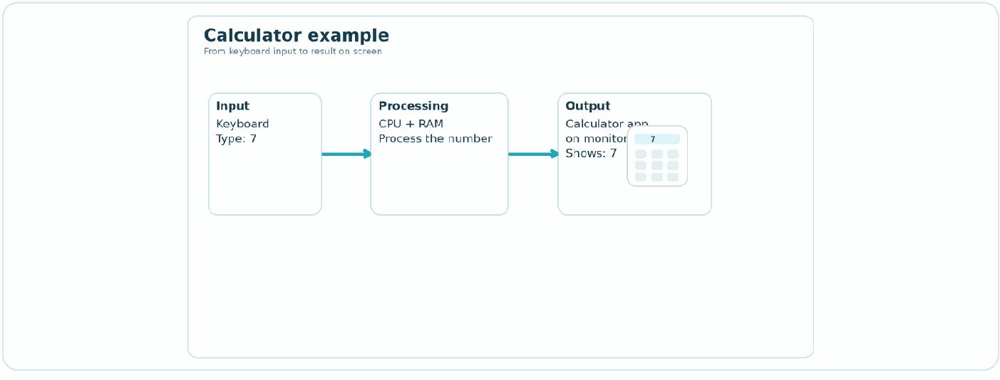

*Figure 1.2 – Calculator example.*

### 1.1.2. How the Subsystems Work Together

Although each subsystem has its own responsibility, they cannot do everything independently.

For example, the CPU is capable of performing calculations, but without memory it would not have the instructions and data needed to perform them. The same can be said about input and output devices, because without them it would be much harder for us to interact with the computer.

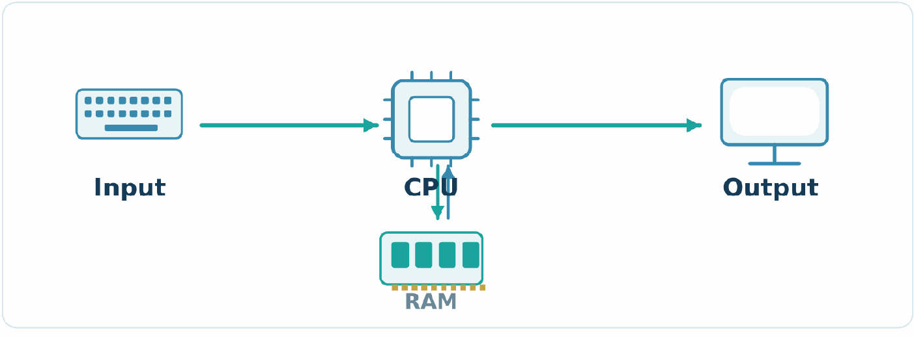

*Figure 1.3 – Computer subsystems.*

### Activity 1: Follow a Keyboard Input

**Goal:** Trace an everyday input through the main computer subsystems.

**Preparation:** Paper and pen; work alone or with a partner.

**Before you read the answers:** Draw three boxes labelled Input, Processing/Memory, and Output. Predict the path of the number.

Imagine that you type the number 7 on a keyboard and a calculator app shows 7 on the screen.

**Try to answer the following questions:**

1. Which device gives information to the computer?

2. Where can the computer temporarily store this information?

3. Which device shows the result?

4. What would happen if the computer could receive keyboard input but had no working output device? Explain your answer.

**Observe and reflect:** Which component can still work if the screen stops displaying the result? Why is visible output not the same thing as processing?

> ✅ **Check your answers:** when you have finished, compare your work with the [suggested answers for Activity 1](#answers-activity-1).

## 1.2. Central Processing Unit (CPU)

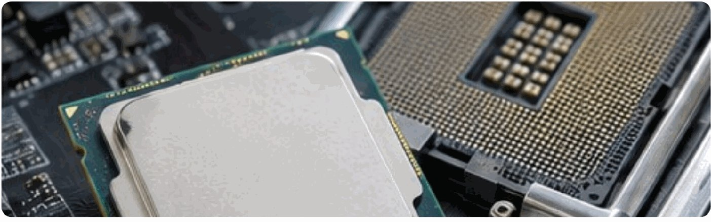

*Figure 1.4 – Processor and motherboard (illustration).*

### Goal

To understand what the CPU does and how its main parts work together to process instructions.

### Learning Objectives

Students will be able to identify the ALU, registers, and control unit, explain their roles, and follow a simple CPU operation.

### 1.2.1. What Is the CPU?

The **CPU** can be considered as the brain of your computer.

In general, the CPU carries out instructions and performs calculations like adding or subtracting numbers. Modern processors can perform billions of operations every second, which allows computers to complete different tasks in a very short time.

However, the CPU does not work independently. It needs instructions and data from memory and also interacts with other hardware components.

In general, the CPU consists of three main parts:

- **Arithmetic Logic Unit (ALU)**
- **Control Unit (CU)**
- **Registers**

Each of these components has its own responsibility, and together they allow the processor to execute instructions.

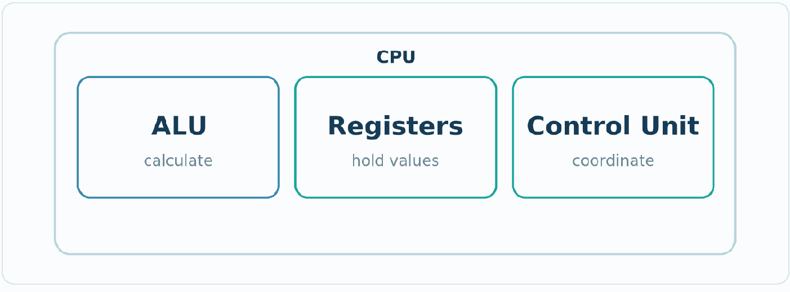

*Figure 1.5 – Main CPU components.*

### 1.2.2. The Arithmetic Logic Unit (ALU)

The **ALU** is the mathematical brain of a computer.

It is responsible for performing arithmetic, logic, and shift operations on data. These operations are performed using electronic circuits inside the processor.

#### Arithmetic Operations

Arithmetic operations are responsible for handling numerical calculations in a computer, like adding, subtracting, multiplying, and dividing numbers.

For example, when a computer needs to calculate **5 + 3**, the ALU can perform this operation and produce the result **8**.

However, depending on the processor, some complicated calculations may require several operations instead of just one.

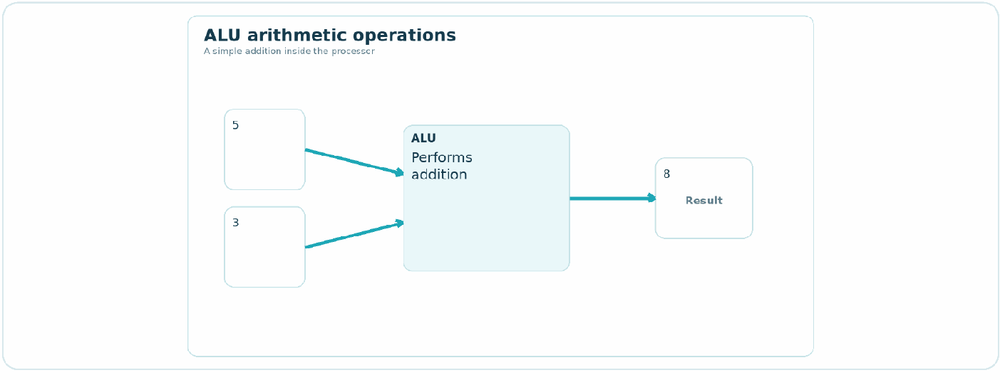

*Figure 1.6 – ALU arithmetic operations.*

#### Shift Operations

Shift operations are used to move bits from left to right or from right to left.

There are two important types of shifts:

- **Logical Shift**
- **Arithmetic Shift**

A logical shift moves bits in one direction and fills empty positions with zeros.

An arithmetic right shift works with signed binary numbers and normally keeps the sign bit.

One interesting thing about shifting is that it can also change the value of a binary number. For example, shifting a number one position to the left can multiply its value by two, while shifting to the right can divide it by two.

However, this depends on the type of shift and whether the number can fit within the available bits.

#### Example: Left Shift

Imagine that we have a binary number 0011, which represents 3.

After shifting it one position to the left, we get:

0011 → 0110

Now the number represents 6 instead of 3.

In this case, the shift has the same effect as multiplying the original number by two.

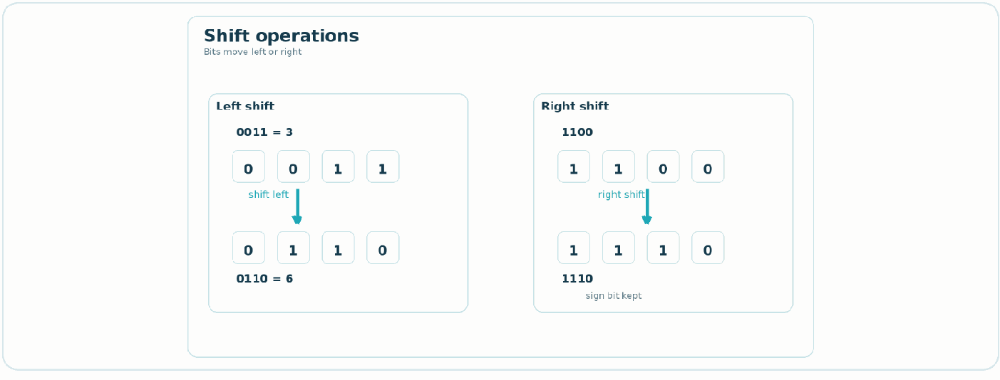

*Figure 1.7 – Shift operations.*

#### Logic Operations

A computer stores our information in the form of bits, which are values of **0 and 1**.

Logic operations help a computer work with these bits. There are four main logic operations which we will discuss:

- **NOT:** Changes 0 to 1 or 1 to 0.
- **AND:** Gives 1 only when both inputs are 1.
- **OR:** Gives 1 when at least one input is 1.
- **XOR:** Gives 1 when the two inputs are different.

With the help of these operations, a computer can process and change binary data.

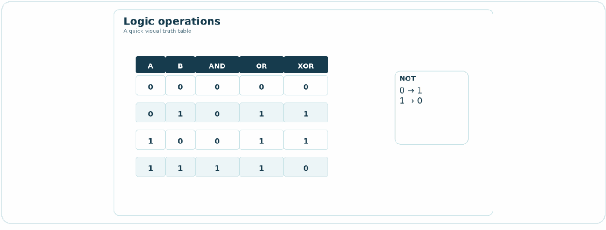

*Figure 1.8 – Logic truth table.*

#### Example: Using AND

For example, imagine that a system has two conditions which must be satisfied before it performs an action.

The AND operation can be used to check whether both conditions are true. If even one of them is false, the result will be 0.

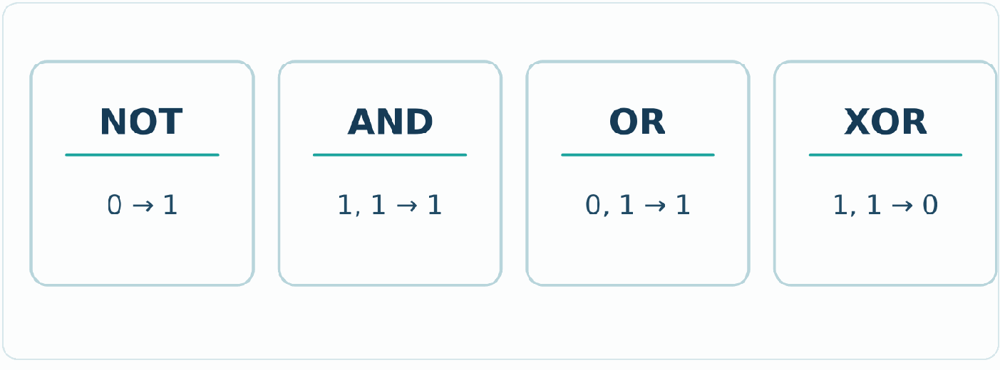

*Figure 1.9 – Logic operations.*

### 1.2.3. Registers

Registers are small independent storage locations inside the CPU that can temporarily store information.

Several registers are needed for the processor to work properly.

You may wonder why the CPU needs registers if a computer already has RAM. The reason is that registers are much faster and allow the CPU to access the information it is currently working with very quickly.

However, there are fewer registers than memory locations in RAM.

#### Data Registers

Older computers often used a small number of registers to store input data and operation results.

Modern computers can use more registers inside the CPU to speed up their work, because the processor can keep frequently used values close to where calculations are performed.

Data registers are labelled as **R₁ … Rₙ** in Figure 1.10 below.

For example, if the CPU needs to calculate 5 + 3, the two numbers can be stored in separate data registers before being used by the ALU.

After the calculation, the result can be stored in another register.

#### Instruction Register

Nowadays, memory stores not only data but also programs.

The CPU is responsible for fetching instructions from memory one by one, decoding them, and executing them.

The **Instruction Register (IR)** temporarily stores the instruction which the CPU is currently processing.

#### Program Counter

The last register we will discuss is the **Program Counter (PC)**.

Its main responsibility is to keep the address of the next instruction that the CPU should fetch from memory.

Normally, after fetching an instruction, the CPU moves to the next one. However, some instructions can change this order, for example when a program needs to jump to another part of its code.

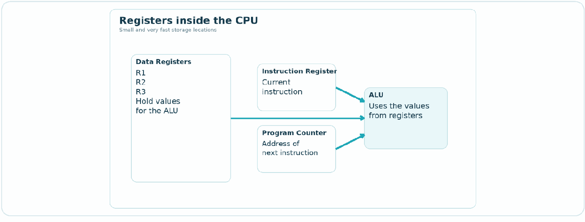

*Figure 1.10 – Registers inside the CPU.*

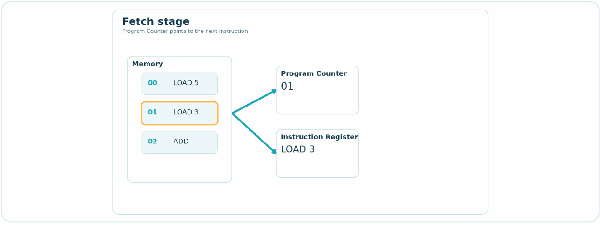

*Figure 1.11 – Program Counter and Instruction Register.*

### 1.2.4. The Control Unit

Not a single CPU will work properly without a **Control Unit**.

As the name suggests, it controls and coordinates the operation of different CPU components. It does this by sending control signals to other components and making sure that instructions are carried out correctly.

However, the Control Unit does not perform calculations itself. This responsibility belongs to the ALU.

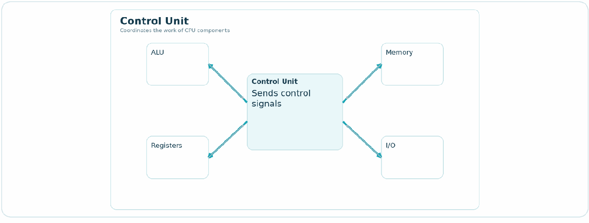

*Figure 1.12 – Control Unit coordination.*

#### Worked Example: Adding 5 + 3

To understand how these components work together, let's imagine that our CPU needs to calculate:

**5 + 3 = ?**

The process can be divided into several steps:

1. **Registers:** First, the numbers 5 and 3 are available in two data registers.

2. **Control Unit:** The Control Unit coordinates the operation and tells the ALU which calculation needs to be performed.

3. **ALU:** The ALU performs the addition and produces the result 8.

4. **Registers:** Finally, the result can be stored in another register and later transferred to memory.

This is a simplified example, but it shows us how the ALU, registers, and Control Unit work together to perform even a simple calculation.

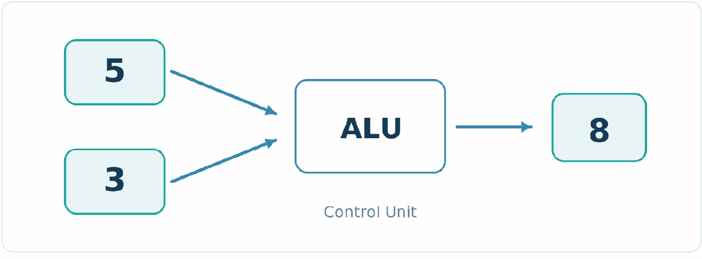

*Figure 1.13 – Addition inside the CPU.*

### Activity 2: Understanding CPU Components

**Goal:** Connect the responsibilities of the ALU, registers, Control Unit, and instruction registers.

**Preparation:** Revisit the CPU diagram, then try the questions without your notes.

Now that we have discussed the main parts of the CPU, try to identify which component is responsible for each task.

#### Part A: Who Am I?

Match each statement with the **ALU, Data Register, Instruction Register, Program Counter, or Control Unit**.

1. I keep the instruction that the CPU is currently working on.

2. I perform an AND operation on two bit patterns.

3. I temporarily hold a number while the CPU is using it.

4. I keep the address of the next instruction to fetch.

5. I coordinate what other parts of the CPU do.

#### Part B: Find the Mistake

A student writes:

*"The Control Unit adds two numbers, and the ALU decides which instruction should be executed next."*

**What is wrong with this explanation?**

Try to rewrite it in one or two sentences.

**Observe and reflect:** What goes wrong when the ALU and Control Unit are confused? Explain their different responsibilities in one sentence.

> ✅ **Check your answers:** when you have finished, compare your work with the [suggested answers for Activity 2](#answers-activity-2).

## 1.3. Main Memory

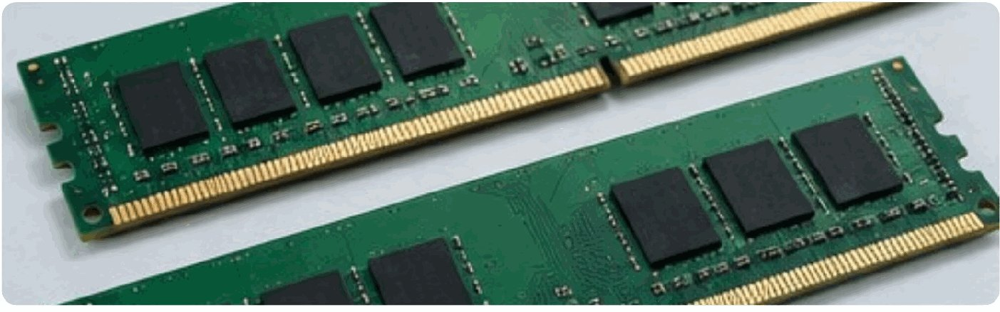

*Figure 1.14 – RAM modules (illustration).*

### Goal

To understand how computers store information, how memory locations work, and why different types of memory are needed.

### Learning Objectives

By the end of this section, students will be able to:

- Explain the purpose of main memory.
- Understand how data is stored using bits and bytes.
- Explain what a memory address is.
- Describe the difference between RAM and ROM.
- Explain why computers use cache memory.
- Compare registers, cache, and RAM.

### 1.3.1. How Does Computer Memory Work?

A computer needs a place to keep the information it is currently working with.

This is the responsibility of **Main Memory**.

Main memory stores data and program instructions which the CPU needs while programs are running.

However, computers do not store information in the same way that we write words or numbers on paper.

Instead, they represent information using binary digits called **bits**.

A bit can have only two possible values:

- **0**
- **1**

Eight bits together form one **byte**.

For example, the binary number 00000101 represents the decimal number 5.

Computers use combinations of bits to represent numbers, letters, instructions, and other information.

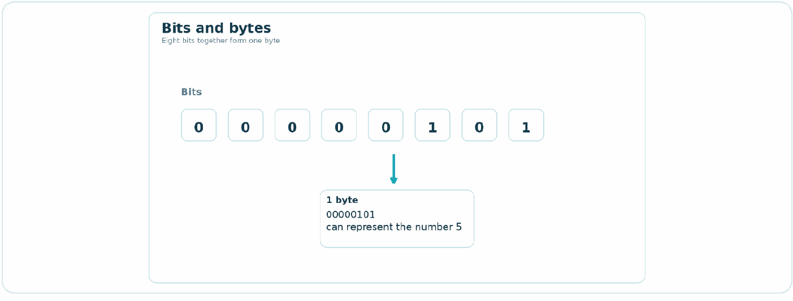

*Figure 1.15 – Bits and bytes.*

#### Memory Addresses

Imagine that memory consists of many small storage locations.

Each location has its own address, which allows the computer to find the information stored there.

A memory address can be compared to a house address. If you want to send something to a particular house, you need to know where it is located.

The same idea applies to computer memory.

For example:

| **Memory Address** | **Value** |
|---|---|
| 00 | 12 |
| 01 | 4 |
| 02 | 9 |
| 03 | 12 |

In this simplified example, address 02 contains the value 9.

If the CPU needs this value, it can request the information stored at that address.

**Important:** The address tells the computer where the information is stored. The value is the actual information at that location.

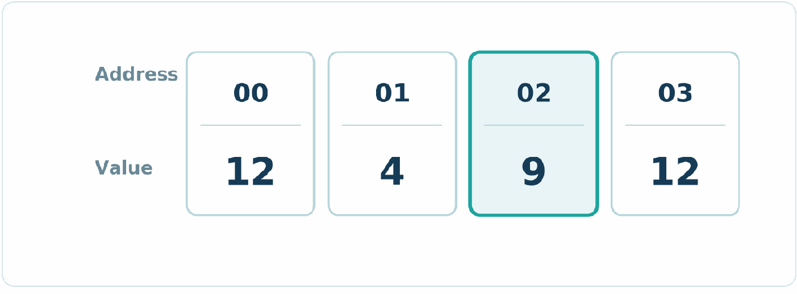

*Figure 1.16 – Memory addresses.*

### 1.3.2. RAM and ROM

Although both RAM and ROM are types of memory, they have different responsibilities.

#### Random Access Memory (RAM)

**RAM** is the working memory of a computer.

It temporarily stores information which programs are currently using.

For example, when you open a browser, the computer uses RAM to hold the information needed while the browser is running.

One important characteristic of RAM is that it is usually **volatile**.

This means that the information stored in RAM is lost when the computer loses power.

However, this does not mean that every file disappears when you turn off your computer. Files that have been saved to secondary storage can remain there.

#### Read-Only Memory (ROM)

**ROM** is a type of nonvolatile memory.

Traditionally, ROM is used to store instructions that do not need to change during normal computer operation.

For example, computers need firmware that helps initialize hardware when the system starts.

Some firmware is stored in nonvolatile memory, such as flash memory, which can be updated.

Unlike ordinary RAM, this type of memory keeps its information even when the computer is turned off.

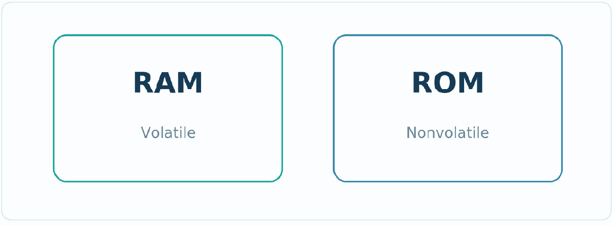

*Figure 1.17 – RAM and ROM.*

#### RAM vs. ROM

| **RAM** | **ROM** |
|---|---|
| Used for temporary working information | Traditionally used for firmware or fixed instructions |
| Normally volatile | Nonvolatile |
| Can be read and written during normal operation | Traditionally read-only, although modern firmware storage may be updated |
| Used while programs are running | Helps store instructions needed for specific system functions |

#### Common Misconception

***"If RAM loses information when the computer turns off, all my files will disappear."***

This is incorrect.

RAM is temporary working memory. Files saved to nonvolatile storage, such as an SSD, can remain available after the computer is turned off.

### 1.3.3. Memory Hierarchy and Cache

A computer needs memory that is fast, large, and affordable. However, faster memory usually costs more and cannot always store large amounts of information.

Because of this, computers use different types of memory, each of which has its own responsibility.

The three main types we will discuss are:

- **Registers:** Small storage locations inside the CPU. They are extremely fast but can hold only a small amount of information.
- **Cache Memory:** Small and fast memory that stores copies of data and instructions which the CPU is likely to use soon.
- **Main Memory (RAM):** Memory that stores information and instructions which programs are currently using. It has much more space than registers or cache, but it is generally slower.

#### Memory Hierarchy

The usual order from fastest and smallest to slower and larger is:

**Registers → Cache → RAM**

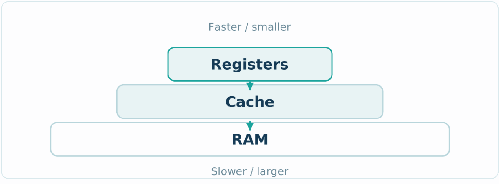

*Figure 1.18 – Memory hierarchy.*

#### Example: Understanding Memory Hierarchy

Imagine that you are studying for an exam.

The information you are currently using is like something you are holding in your hand. This can be compared to a **Register**.

The notes you often check are placed on your desk, so you can easily reach them. This is similar to **Cache Memory**.

Your notebook contains much more information, but finding something inside it takes more time. This can be compared to **RAM**.

This example is simplified, but it shows why computers keep frequently used information closer to the CPU.

#### How Does Cache Work?

Let's imagine that the CPU needs some information which is stored in RAM.

The process can be divided into several steps:

1. The CPU needs a particular piece of data.

2. The processor checks whether this information is already available in cache.

3. If the data is there, the CPU can access it quickly.

4. If it is not there, the system retrieves the needed information from RAM.

5. A copy may also be placed in cache so the CPU can access it faster next time.

This is one of the reasons why cache memory helps computers work faster.

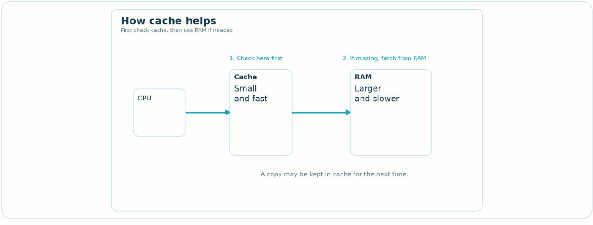

*Figure 1.19 – How cache helps.*

**Important:** Cache does not replace RAM. It works together with RAM to reduce the time needed to access frequently used information.

#### Common Misconception

***"Cache memory and RAM are basically the same thing."***

Although both store information, they have different responsibilities.

Cache is much smaller and faster. It keeps copies of data that the CPU is likely to need soon, while RAM stores a much larger amount of information used by running programs.

### Activity 3: Memory Detective

**Goal:** Understand the difference between a memory address and the value stored at that address.

**Preparation:** Paper and pen. No computer is required.

**Try it:** The following imaginary memory contains decimal values.

| **Address** | **Value** |
|---|---|
| 00 | 12 |
| 01 | 4 |

| **Address** | **Value** |
|---|---|
| 02 | 9 |
| 03 | 12 |

1. Predict the value returned if the CPU asks for address 02.

2. Identify two addresses that contain the same value.

3. Change the value at address 01 from 4 to 7. Does the address itself change? Explain.

4. A program needs the number 12. Is there only one address it could read from?

**Observe and reflect:** Which part of the table identifies *where* data is, and which part tells you *what* the data is?

> ✅ **Check your answers:** when you have finished, compare your work with the [suggested answers for Activity 3](#answers-activity-3).

## 1.4. Input/Output Subsystem and Storage

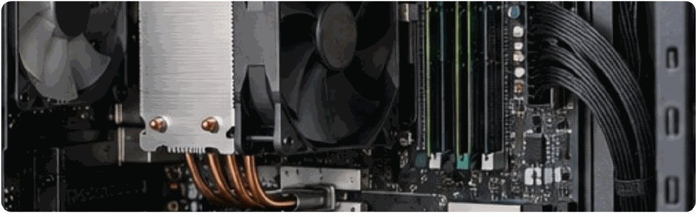

*Figure 1.20 – Inside a desktop PC (illustration).*

### Goal

To understand how computers receive information, display results, and store files for future use.

### Learning Objectives

By the end of this section, students will be able to:

- Explain the difference between input and output devices.
- Identify common examples of input/output hardware.
- Understand the purpose of secondary storage.
- Explain the difference between RAM and SSD/HDD.
- Describe how a computer uses memory and storage when running a program.

### 1.4.1. Input and Output Devices

The **Input/Output subsystem (I/O)** is the third major subsystem of a computer.

Its main responsibility is to allow the computer to receive information from the outside world and send information back.

There are two main categories of devices:

#### Input Devices

Input devices allow users to send information into a computer.

Some common examples are:

- Keyboard
- Mouse
- Microphone
- Camera

#### Output Devices

Output devices allow a computer to display information or perform an output action.

Some common examples are:

- Monitor
- Speakers
- Printer

#### Example: Typing a Sentence

Imagine that you are writing a document on your computer.

When you press a key on your keyboard, the computer receives information through an input device.

After that, the computer processes the information, and the letter appears on your monitor, which is an output device.

However, not every device belongs to only one category.

For example, a **touchscreen** can work as both an input and an output device. It displays information while also allowing users to interact with the computer by touching the screen.

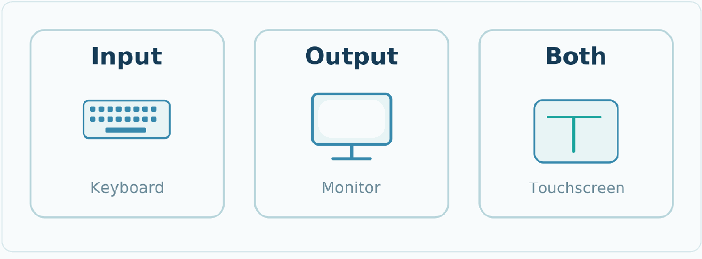

*Figure 1.21 – Input and output.*

### 1.4.2. Secondary Storage

Computers need to store programs, pictures, documents, and other files even after they are turned off.

This is the main responsibility of **Secondary Storage**.

Unlike RAM, secondary storage can keep information without a continuous power supply.

There are several types of storage devices.

#### Hard Disk Drive (HDD)

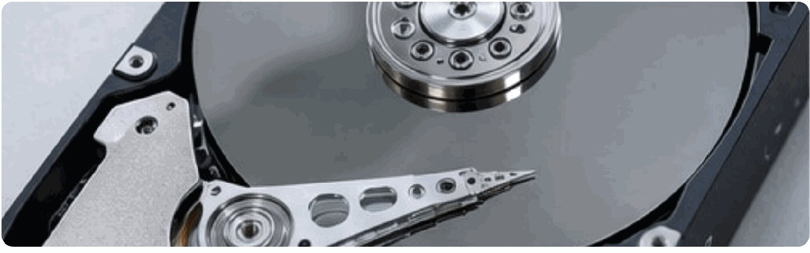

*Figure 1.22 – Inside a hard drive (illustration).*

A **Hard Disk Drive (HDD)** stores information magnetically on spinning disks.

HDDs are commonly used when large storage capacity is needed. They contain moving mechanical parts.

#### Solid-State Drive (SSD)

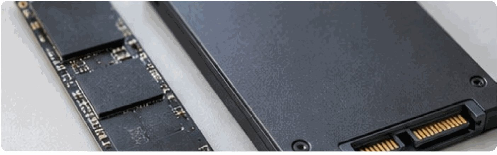

*Figure 1.23 – Solid-state storage (illustration).*

A **Solid-State Drive (SSD)** stores information electronically using flash memory.

Unlike HDDs, SSDs do not have spinning disks.

SSDs are generally faster than HDDs, especially when accessing many small files or loading programs.

#### Optical Storage

Another type of storage is optical storage, such as **CDs and DVDs**.

These devices use laser technology to read information stored on discs.

Although they are less common in modern computers, they are still an example of how information can be stored using different technologies.

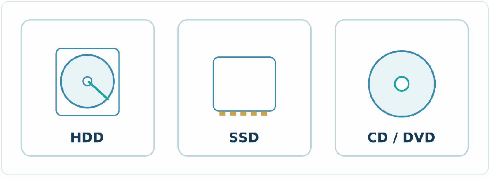

*Figure 1.24 – Secondary storage.*

### 1.4.3. Memory vs. Storage

RAM and secondary storage may seem similar because both are used to keep information.

However, they have different responsibilities.

**RAM** holds information that a program is currently using.

**Secondary Storage** keeps programs and files so that they can be opened again later.

One important difference is that RAM is normally **volatile**, which means it loses its contents when power is turned off.

SSDs and HDDs are **nonvolatile**, meaning they can keep stored information even without power.

| **RAM** | **SSD / HDD** |
|---|---|
| Temporary working memory | Long-term storage |
| Normally loses information without power | Keeps information without power |
| Used by running programs | Used to save programs and files |
| Generally faster to access | Generally slower than RAM |

#### Example: Playing a Video Game

Imagine that you have a game installed on your computer.

The game files are stored on an SSD or HDD.

When you open the game, the computer loads the necessary information into RAM.

During gameplay, the CPU works with the instructions and data that are currently needed.

When you close the game, the files remain on your storage device, so you can open it again later.

This example shows why computers need both RAM and secondary storage.

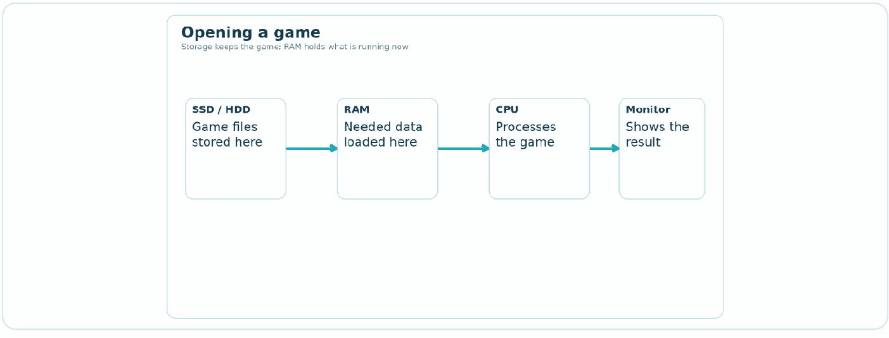

*Figure 1.25 – Opening a game: storage to RAM to CPU.*

#### Common Misconception

***"If my computer has more RAM, I can store more games and files."***

This is not exactly how it works.

RAM helps your computer work with running programs, while SSDs and HDDs are responsible for keeping your files.

For example, increasing RAM does not automatically increase the amount of space available for installing games.

### Activity 4: What Happens When Power Is Off?

**Goal:** Compare volatile working memory with nonvolatile storage.

**Preparation:** Read the RAM vs. Storage table, then predict what each student can recover.

Imagine that two students are writing documents on their computers.

**Student A** has saved the document to an SSD before the computer suddenly loses power.

**Student B** has been writing for an hour but has not saved the latest changes when the computer loses power.

**Questions:**

1. Why might Student B lose the latest changes?

2. Why can Student A open the saved document again?

3. Which type of memory is normally volatile?

4. Compare the two situations. What is the main difference between saving a document and keeping it open in RAM?

**Observe and reflect:** Which change actually keeps the essay for the next day: keeping it open or saving it? Why?

> ✅ **Check your answers:** when you have finished, compare your work with the [suggested answers for Activity 4](#answers-activity-4).

## 1.5. Subsystem Interconnection

### Goal

To understand how the CPU, memory, and input/output devices communicate and exchange information.

### Learning Objectives

By the end of this section, students will be able to:

- Explain what a bus is.
- Identify the roles of the Data Bus, Address Bus, and Control Bus.
- Understand the basic purpose of input/output controllers.
- Describe how information moves between computer components.

### 1.5.1. Buses

A computer consists of many different components, but these components need a way to communicate with each other.

For this purpose, computers use communication connections called **Buses**.

In a simplified computer model, a bus can be considered as a path through which information travels between different hardware components.

There are three important types of buses which we will discuss:

#### Data Bus

The **Data Bus** carries the actual data being transferred between components.

For example, if the CPU needs a number from memory, the data bus carries that number.

#### Address Bus

The **Address Bus** carries information about the location which the CPU wants to access.

Imagine that the CPU needs a specific value stored in memory. It needs to know where this value is located.

The address bus helps identify this location.

#### Control Bus

The **Control Bus** carries signals that coordinate different operations.

For example, it can indicate whether the CPU wants to read information from memory or write new information into it.

#### Example: Reading Information from Memory

Let's imagine that the CPU needs a number stored at memory address 12.

The process can be explained using three main steps:

1. **Address Bus:** The CPU identifies the memory location it wants to access.

2. **Control Bus:** A control signal indicates that the CPU wants to read the information.

3. **Data Bus:** The requested data is transferred from memory to the CPU.

This is a simplified explanation, but it shows that different buses have different responsibilities.

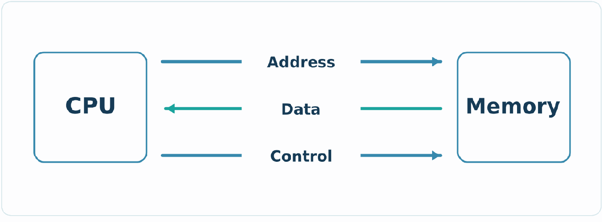

*Figure 1.26 – Data, address, and control buses.*

**Important:** Modern computers can use more complicated communication systems. However, this simplified model helps us understand the main purpose of buses.

### 1.5.2. Input/Output Controllers

Different input and output devices do not always work in the same way or at the same speed as the CPU.

For this reason, computers use **Input/Output Controllers**.

A controller helps the computer communicate with a device and manages the transfer of information.

#### Example: USB Controller

For example, when you connect a keyboard or an external storage device to your computer through USB, a USB controller helps manage communication between the device and the computer.

USB is a common connection system used by many different devices.

We do not need to study every USB version or connector type.

The important thing is to understand that controllers help different hardware components communicate and work together.

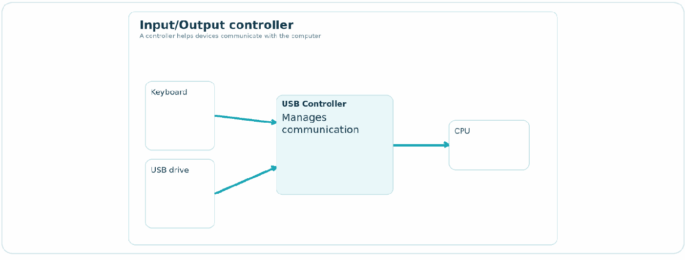

*Figure 1.27 – USB controller example.*

### Activity 5: Follow the Data

**Goal:** Trace an address, a read command, and returned data through the simplified bus model.

**Preparation:** Draw three arrows between a CPU box and a Memory box: Address, Control, and Data.

Imagine that the CPU wants to read the number stored at memory address 15.

The memory contains the following information:

| **Memory Address** | **Value** |
|---|---|
| 14 | 20 |
| 15 | 8 |
| 16 | 12 |

**Questions:**

1. Which bus carries the address 15?

2. Which bus carries the signal telling memory to read information?

3. Which bus transfers the requested value back to the CPU?

4. What number will the CPU receive?

5. What would happen if the CPU requested address 16 instead of 15? Explain your answer.

**Observe and reflect:** If the address changes, which bus carries the new address, and which bus returns the different value?

> ✅ **Check your answers:** when you have finished, compare your work with the [suggested answers for Activity 5](#answers-activity-5).

## 1.6. Program Execution

### Goal

To understand how computers follow instructions and how the CPU, registers, memory, and buses work together during program execution.

### Learning Objectives

By the end of this section, students will be able to:

- Explain the stored-program concept.
- Describe the Fetch–Decode–Execute cycle.
- Identify the roles of the Program Counter and Instruction Register.
- Explain how a computer follows a simple program.
- Understand how the main CPU components work together during execution.

### 1.6.1. Stored-Program Concept

Modern general-purpose computers can store both program instructions and data in memory.

This is known as the **Stored-Program Concept**.

In simple words, a computer does not need completely different hardware for every task. Instead, it can follow different sets of instructions depending on which program is running.

#### Example: Different Programs on One Computer

Imagine that you have a computer which you use for studying, playing games, and browsing the internet.

When you open a calculator, the computer follows instructions that allow it to perform calculations.

When you open a game, it follows a completely different set of instructions.

Although the programs are different, the same computer can execute them.

This is possible because computers can store different programs and follow their instructions.

#### Program Instructions vs. Data

Although instructions and data can both be stored in memory, they have different purposes.

- **Program Instructions:** Tell the computer what operation needs to be performed.
- **Data:** The information which the computer works with.

For example, if a calculator needs to calculate 5 + 3, the numbers 5 and 3 are data, while the instruction to add them is part of the program.

This difference is important because it helps us understand what the CPU actually does when executing a program.

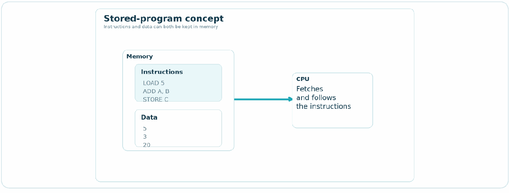

*Figure 1.28 – Stored-program concept.*

### 1.6.2. Fetch–Decode–Execute Cycle

Now that we understand that computers store programs in memory, the next question is:

**How does the CPU actually follow these instructions?**

The answer is a repeating process called the **Fetch–Decode–Execute Cycle**.

This process consists of three main steps.

#### Step 1: Fetch

During the Fetch stage, the CPU retrieves the next instruction from memory.

The **Program Counter (PC)** holds the address of the instruction that needs to be fetched.

After the instruction is fetched, it is placed in the **Instruction Register (IR)**.


*Figure 1.29 – Fetch stage.*

#### Step 2: Decode

After receiving the instruction, the CPU needs to understand what it should do.

During the Decode stage, the **Control Unit** interprets the instruction and determines which operation is required.

For example, it may identify that the CPU needs to add two numbers.

#### Step 3: Execute

During the Execute stage, the CPU performs the required operation.

Depending on the instruction, this may involve:

- Performing a calculation using the ALU.
- Reading or writing data.
- Moving information between registers.
- Performing another required operation.

After the instruction is completed, the CPU continues with the next instruction.

However, some instructions, such as jumps, can change which instruction comes next.

#### Fetch–Decode–Execute Diagram

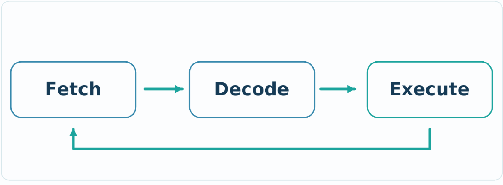

*Figure 1.30 – Fetch–Decode–Execute.*

#### Common Misconception

***"The CPU executes an instruction first and only after that understands what it means."***

This is incorrect.

The CPU must first **Fetch** an instruction from memory, then **Decode** it to determine what operation is required, and finally **Execute** it.

The cycle repeats as the CPU continues processing instructions.

### 1.6.3. Worked Example: Adding Two Numbers

We have already discussed how the CPU can perform calculations using the ALU, registers, and Control Unit.

Now we will look at the same example from another perspective.

Instead of focusing only on CPU components, we will see how a simple program is executed.

Imagine that the computer needs to calculate:

**5 + 3 = 8**

The numbers and program instructions are available in memory.

A simplified sequence of operations would look like this:

1. The CPU fetches an instruction telling it to load the first number.

2. The value 5 is placed in a register.

3. The CPU follows another instruction and loads 3 into a second register.

4. The CPU fetches and decodes an addition instruction.

5. The ALU adds 5 and 3, producing the result 8.

6. The result is placed in another register and can later be stored in memory.

7. If the program needs to display the result, the computer sends the information to an output device.

This example shows that a computer does not calculate using only one component.

The CPU, memory, registers, ALU, and Control Unit all have different responsibilities.

#### Example: A Simple Program

The following is an imaginary program written in plain English instead of real machine code.

| **Address** | **Instruction** |
|---|---|
| 00 | LOAD 5 into Register A |
| 01 | LOAD 3 into Register B |
| 02 | ADD A and B, put result in Register C |
| 03 | STORE Register C at memory address 20 |
| 04 | HALT |

In this example, the computer follows instructions one by one.

First, it loads the values 5 and 3 into registers.

After that, the ALU performs the addition and places the result in Register C.

Finally, the result is stored at memory address 20, and the program stops.

**HALT** is an instruction that tells the processor to stop executing this program.

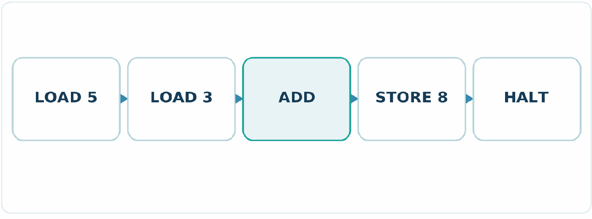

*Figure 1.31 – A simple program.*

### Activity 6: Be the CPU

**Goal:** Trace a program and predict how changing an instruction affects its result.

**Preparation:** Copy the instruction table and draw three register boxes labelled A, B and C.

Now imagine that you are the CPU executing the program above.

#### Part A: Follow the Instructions

Try to answer the following questions:

1. What value is stored in Register A after the first instruction?

2. What value is stored in Register B after the second instruction?

3. What result does the ALU produce?

4. At which memory address is the result stored?

5. Which instruction stops the program?

#### Part B: Predict the Result

Now imagine that we change some instructions in our program.

1. What would happen if the second instruction loaded **7 instead of 3** into Register B?

2. What would happen if we kept the original values 5 and 3, but replaced the ADD instruction with **SUBTRACT A minus B**?

3. Would changing the addition instruction also change the memory address where the result is stored? Explain your answer.

**Observe and reflect:** Which instructions change a value, and which instructions only move or store it?

> ✅ **Check your answers:** when you have finished, compare your work with the [suggested answers for Activity 6](#answers-activity-6).

### Optional Interactive Lab: See a CPU Execute Instructions

**Goal:** Watch a simple educational CPU fetch, decode and execute the same "5 + 3" program that you traced in Activity 6.

**Resource:** Little Man Computer (LMC), a free browser simulator by Peter Higginson: https://peterhigginson.co.uk/lmc/ (no account or installation needed).

**Preparation:** A computer with a web browser (about 15 minutes). LMC has only **one** working register, the **accumulator**, so the program below adds 3 directly to the accumulator instead of using Registers A, B and C.

**Task**

1. Open the simulator. Delete any code in the large program box on the left and type (or paste) this program:

```text
        LDA FIVE     // load the number stored at FIVE into the accumulator
        ADD THREE    // add the number stored at THREE
        STA RESULT   // store the accumulator at RESULT
        OUT          // show the accumulator in the OUTPUT box
        HLT          // stop
FIVE    DAT 5
THREE   DAT 3
RESULT  DAT 0
```

2. Put the program into memory. Depending on the version of the page, click **ASSEMBLE INTO RAM**, or the simulator assembles the code automatically as soon as you type it. The memory boxes 00–07 should now contain numbers.
3. Before you run anything, **predict:** what will the Program Counter show after the first instruction? What will the accumulator hold after the second instruction? Which memory box will change, and to what?
4. Click **STEP** (not RUN) once for each instruction and watch the Program Counter, the accumulator and the memory boxes. Record what changed after each step in a table like the one below.
5. Change `THREE DAT 3` to `THREE DAT 7`, put the program into memory again, press **RESET** and run it again. What is the new output?

| Step | Instruction | Program Counter after the step | Accumulator | What else changed? |
|---|---|---|---|---|
| 1 | LDA FIVE | | | |
| 2 | ADD THREE | | | |
| 3 | STA RESULT | | | |
| 4 | OUT | | | |
| 5 | HLT | | | |

**Observe and reflect:** Which instructions only *move* a value, and which one *changes* it? Where is the "decode" step happening, even though you cannot see it?

**If the simulator is not available (offline fallback):** do the same task on paper. Copy the program, draw eight memory boxes (00–07) and one accumulator box, and follow the five instructions by hand. The expected results in the answer key are the same for both versions.

**Important limitation:** LMC is an educational model, not a complete picture of a modern processor. Real CPUs have many registers, caches and execution features.

> ✅ **Check your answers:** when you have finished, compare your work with the [suggested answers for the Interactive Lab](#answers-cpu-lab).

## 1.7. Sensors, Actuators and Microcontrollers

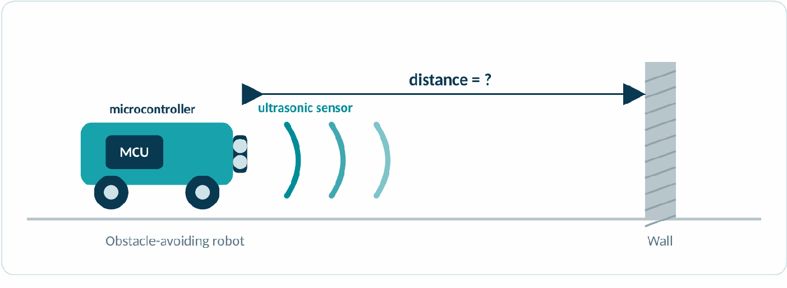

*Figure 1.32 – Our running example: an obstacle-avoiding robot measures the distance to a wall with sound.*

### Goal

To understand how a machine can sense the physical world, make a decision with a tiny computer, and act on that decision, using one robot example from start to finish.

### Learning Objectives

By the end of this section, students will be able to:

- Explain the difference between a sensor and an actuator, and give examples of each.
- Distinguish digital sensors (on/off) from analog sensors (a range of values).
- Describe how a sensor signal becomes numbers a computer can use (sampling, quantization and encoding), and explain resolution and sampling rate.
- Explain why sensor readings are noisy and how averaging helps.
- Explain how a microcontroller controls motor speed with PWM and motor direction with a motor driver (H-bridge).
- Describe what is inside a microcontroller and how its program is organised (setup and loop).
- Calculate a distance from the echo time of an ultrasonic sensor.
- Trace the program of an obstacle-avoiding robot, predict what it will do, and design a simple sensing device of your own.

**Where this fits.** In Section 1.4 you met input devices (keyboard, microphone, camera) and output devices (monitor, speakers). In Section 1.6 you watched the CPU repeat the fetch–decode–execute cycle. A robot uses the same ideas, but its "keyboard" is a sensor that measures the world and its "monitor" is a motor that moves it.

**Predict first.** A robot is driving toward a wall. How could it know the wall is there? Write your guess in one sentence, then check it against Section 1.7.5.

### 1.7.1. Sensors: How a Machine Senses the World

A **sensor** is a device that measures something in the physical world (sound, light, distance, temperature, movement, pressure) and turns it into an electrical signal. A sensor is an input device, but instead of a person typing, the "input" comes from the real world.

| **Sensor** | **What it measures** | **Example use** |
|---|---|---|
| **Microphone** | sound | voice commands |
| **Camera** | light (images) | face unlock, robot vision |
| **Ultrasonic range sensor** | distance to an object (by timing an echo) | obstacle-avoiding robot |
| **Infrared (IR) sensor** | reflected infrared light | line-following robot, TV remote receiver |
| **Light sensor** | brightness | automatic night light, phone screen brightness |
| **Temperature sensor** | temperature | thermostat |
| **Bumper (touch) switch** | whether it is pressed | robot vacuum hitting a chair |
| **Gyroscope / accelerometer** | rotation / motion | a phone knows its orientation |
| **Wheel encoder** | how far a wheel has turned | a robot measures how far it drove |

#### Digital and analog sensors

Some sensors can only say **yes or no**. A bumper switch is either pressed (1) or not pressed (0). We call this a **digital** sensor: its output is one bit.

Other sensors give a value anywhere in a **range**. A light sensor's voltage rises smoothly as the room gets brighter. We call this an **analog** sensor. Before a computer can use an analog value, it must be turned into a number.

| | **Digital sensor** | **Analog sensor** |
|---|---|---|
| **Output** | only two values: 0 or 1 | any value in a range |
| **Example** | bumper switch, button | light sensor, temperature sensor |
| **What the program asks** | "Is it pressed?" | "How bright is it?" |

#### From signal to numbers

Turning an analog signal into numbers is called **analog-to-digital conversion**, and it has three steps:

1. **Sampling:** measure the signal at regular moments. The number of measurements per second is the **sampling rate**.

2. **Quantization:** round each measured value to the nearest whole number (the nearest step the converter can store).

3. **Encoding:** write that whole number as a pattern of bits. The number of bits per sample is the **bit depth**.

**Worked example.** An imaginary converter has 3 bits, so it can output the whole numbers 0 to 7 (2³ = 8 values).

| **Sample** | **Real value (volts)** | **After quantization** | **3-bit code** |
|---|---|---|---|
| **1** | 1.3 | 1 | 001 |
| **2** | 3.8 | 4 | 100 |
| **3** | 5.2 | 5 | 101 |
| **4** | 4.1 | 4 | 100 |
| **5** | 2.2 | 2 | 010 |
| **6** | 0.8 | 1 | 001 |

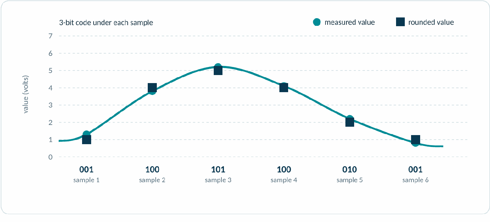

*Figure 1.33 – Sampling, quantization and encoding: a smooth signal becomes a list of 3-bit codes.*

The converter never sees the values *between* the samples, and rounding throws away small differences. More samples per second and more bits per sample give a more accurate picture, but they need more storage and more processing.

#### Resolution: how fine are the steps?

The bit depth decides how many different values a converter can tell apart. This is its **resolution**.

| **Bits** | **Number of values** | **Range of numbers** |
|---|---|---|
| **3** | 2³ = 8 | 0 to 7 |
| **8** | 2⁸ = 256 | 0 to 255 |
| **10** | 2¹⁰ = 1,024 | 0 to 1023 |

A real example: the converter inside the Arduino Uno's microcontroller has **10 bits**. With the usual 5 V reference it turns 0 V into 0 and 5 V into 1023, so each step is about 5 V ÷ 1024 ≈ 0.005 V (5 millivolts). A sensor voltage of 2.5 V, half of 5 V, is read as about 512.

#### Sampling rate: is the robot looking often enough?

A robot only knows what the world looked like at its last sample. Between samples it is "blind". Suppose our robot drives at 0.3 m/s (30 cm per second):

| **Readings per second** | **Time between readings** | **Distance driven between readings** |
|---|---|---|
| **2** | 0.5 s | 30 cm/s × 0.5 s = 15 cm |
| **10** | 0.1 s | 30 cm/s × 0.1 s = 3 cm |
| **20** | 0.05s | 30 cm/s × 0.05 s = 1.5 cm |

With only 2 readings per second, the wall can come 15 cm closer before the robot notices, which is most of its 20 cm safety distance. A faster or more dangerous machine needs a higher sampling rate.

#### Noise: why readings jump

Real sensors are never perfectly steady. Electrical interference, a soft surface that absorbs sound, or a slightly tilted wall can make the reading jump, even when nothing moves. This unwanted variation is called **noise**. For example, a robot standing still in front of a wall might read: 21, 19, 26, 20, 21 cm.

A simple fix is to take several readings and use their **average**. The average of the last three readings 26, 20 and 21 is (26 + 20 + 21) ÷ 3 = 22.3 cm, which is much closer to the true distance than the single wrong reading of 26 cm. The price is a small delay, because the robot must wait for several readings. (The Behaviorist AI chapter shows a second fix for noise near a limit, called hysteresis.)

#### Calibration

The number a sensor gives depends on the sensor, its wiring and the room. A light sensor might read 300 in one classroom and 700 in another. So engineers **calibrate** it: they test it in the real environment and choose the limits (for example, "above 600 means bright") from those tests, instead of guessing.

**Common Misconception**

*"The robot sees the wall."*

The sensor only produces a number. The program turns that number into a distance and compares it with a limit. "Seeing" is just data plus a rule.

### Activity 7: Round It Like a Converter

**Goal:** Practise sampling, quantization and encoding.

**Preparation:** Paper and pen. Use the same imaginary 3-bit converter (values 0 to 7).

A sensor gives these five samples in volts: **0.4, 2.2, 5.7, 6.6, 3.1**.

1. Quantize each sample to the nearest whole number.

2. Write the 3-bit code of each result.

3. Another sample is 1.8 V. Does it get the same code as 2.2 V? What information is lost?

4. Predict: what changes if the converter has 4 bits instead of 3?

5. The sensor is sampled 10 times per second with 3 bits per sample. How many bits per second is that?

**Observe and reflect:** Which step loses information, sampling or quantization?

> ✅ **Check your answers:** when you have finished, compare your work with the [suggested answers for Activity 7](#answers-activity-7).

### Activity 8: Fast Enough? Sampling and Noise

**Goal:** Connect sampling rate and noise to the robot's safety.

**Preparation:** Paper, pen and a calculator. The robot drives at 30 cm per second and must stop when the wall is 20 cm away or closer.

**Part A: Predict**

1. The sensor is read 5 times per second. How far does the robot drive between two readings?

2. A student changes the program so the sensor is read only once per second. Predict what can go wrong.

**Part B: Observe**

1. The robot stands still, 20 cm from a wall. Its readings are 20, 21, 34, 19, 20 cm. Which reading is probably noise?

2. Calculate the average of the last three readings (34, 19, 20).

3. Calculate the average of all five readings.

**Part C: Find the error**

1. A classmate says: "Averaging makes the sensor more accurate, so we should average the last 100 readings." What is the problem? (Hint: at 20 readings per second, how long do 100 readings take, and how far does the robot drive in that time?)

**Observe and reflect:** Why is there always a trade-off between a steady reading and a fast reaction?

> ✅ **Check your answers:** when you have finished, compare your work with the [suggested answers for Activity 8](#answers-activity-8).

### 1.7.2. Actuators: How a Machine Acts

An **actuator** is a device that turns a signal from the computer into a physical action: movement, sound, light or heat. Examples: wheel motors, robot grippers, speakers (including speech output) and LEDs.

| | **Sensor** | **Actuator** |
|---|---|---|
| **Direction** | world → computer | computer → world |
| **Main question** | "What is happening out there?" | "What should happen out there?" |
| **Examples** | microphone, camera, range sensor | wheel motor, gripper, speaker |

#### Three kinds of motor

Most robots move with electric motors, and three kinds are especially common.

| **Motor** | **How it moves** | **Good for** |
|---|---|---|
| **DC motor** | spins continuously while it gets power; more power means faster | wheels of our robot, fans |
| **Servo motor** | turns to a chosen angle (often 0° to 180°) and holds it | steering, a robot arm, a gripper |
| **Stepper motor** | moves in small, exact steps (often 200 steps per turn, 1.8° per step) | 3D printers, moving something to an exact position |

#### Speed control with PWM

A microcontroller's output pin is digital: it is either fully **on** (for example 5 V) or fully **off** (0 V). So how can it make a motor run at half speed?

The trick is **pulse-width modulation (PWM)**. The pin switches on and off very quickly, hundreds of times per second. The motor cannot follow such fast changes, so it reacts to the **average**. The fraction of time the pin is on is called the **duty cycle**.

```text
average voltage = duty cycle × supply voltage

 25 % duty on 5 V:  0.25 × 5 V = 1.25 V   (slow)
 50 % duty on 5 V:  0.50 × 5 V = 2.5 V    (roughly half power – the motor is slower, but not exactly at half speed)
100 % duty on 5 V:  1.00 × 5 V = 5 V      (full speed)
```

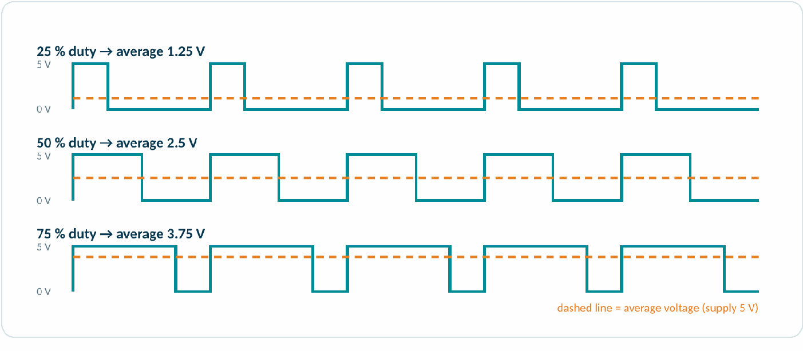

*Figure 1.34 – Pulse-width modulation: the longer the "on" part of each cycle, the higher the average voltage.*

On an Arduino, the instruction analogWrite(pin, value) sets the duty cycle with a number from 0 (always off) to 255 (always on). A value of 128 is about 50 %, and 191 is about 75 %. (The motor's real speed is not exactly proportional to the average voltage, because of friction and load, but the idea of "more on-time, more speed" holds.)

#### Why a motor driver is needed

Input/output devices cannot be wired straight to the CPU and memory, because they work differently and much more slowly. A controller sits between them (Section 1.5.2). A robot follows the same idea. A microcontroller pin can supply only a tiny current (on an Arduino Uno about 20 milliamps is recommended), but a small wheel motor can need hundreds of milliamps. So a **motor driver** board sits between them: the microcontroller sends small control signals, and the driver switches the large current from the battery to the motor.

#### Direction control with an H-bridge

A DC motor spins one way when current flows through it in one direction, and the other way when the current is reversed. Most motor drivers use a circuit called an **H-bridge**: four electronic switches arranged like the letter H around the motor. Closing one diagonal pair sends the current one way; closing the other pair reverses it. The microcontroller controls the switches with two pins, often called IN1 and IN2.

| **IN1** | **IN2** | **Motor** |
|---|---|---|
| **1** | 0 | turns forward |
| **0** | 1 | turns backward |
| **0** | 0 | stops (no power) |

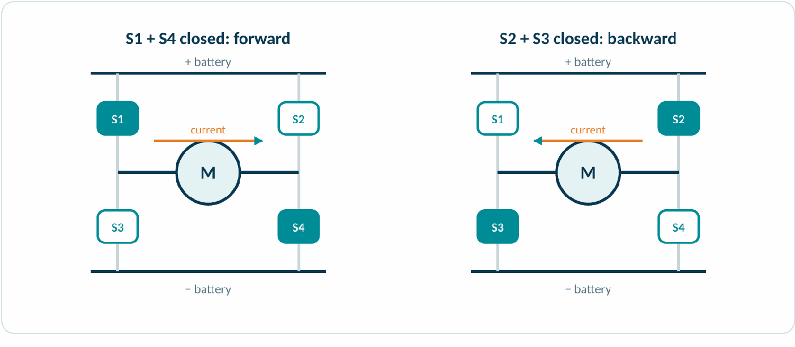

*Figure 1.35 – An H-bridge lets the microcontroller choose the direction of the current, and so the direction of the motor.*

#### Steering with two wheels

Our robot has no steering wheel. It turns by driving its two wheels differently, which is called **differential drive**:

| **Left wheel** | **Right wheel** | **The robot…** |
|---|---|---|
| **forward** | forward | drives straight ahead |
| **forward, fast** | forward, slow | curves to the right |
| **forward** | backward | spins on the spot to the right |
| **stopped** | stopped | stands still |

**Why sensors matter.** Some industrial robot arms work without any sensors. They repeat programmed moves and assume every part arrives in exactly the right place. A robot with sensors can adapt to a world that changes.

### Activity 9: Sensor or Actuator?

**Goal:** Decide whether a device measures the world or changes it.

**Preparation:** Paper and pen.

Label each device **S** (sensor), **A** (actuator) or **B** (both):

1. microphone

2. wheel motor

3. camera

4. speaker

5. gyroscope

6. robot gripper

7. ultrasonic range sensor

8. touchscreen

9. servo motor

10. bumper switch

Then answer: a robot has a camera and wheels but no microcontroller. Can it react to what the camera sees? Why or why not?

**Observe and reflect:** What question did you ask yourself for each device?

> ✅ **Check your answers:** when you have finished, compare your work with the [suggested answers for Activity 9](#answers-activity-9).

### Activity 10: Drive the Motors

**Goal:** Predict what PWM values and H-bridge signals do to the robot.

**Preparation:** Paper, pen and a calculator. The motor driver gets 6 V from the battery. Use average voltage = duty cycle × 6 V, and the H-bridge table above.

**Part A: Calculate**

1. The duty cycle is 50 %. What is the average voltage?

2. The duty cycle is 75 %. What is the average voltage?

3. On an Arduino, which analogWrite value gives about 25 %? (255 means 100 %.)

**Part B: Predict**

1. Left motor: IN1 = 1, IN2 = 0. Right motor: IN1 = 0, IN2 = 1. What does the robot do?

2. Both motors turn forward, but the left motor runs at 100 % and the right motor at 50 %. Which way does the robot curve?

**Part C: Find the error**

1. A student connects the wheel motor directly to a microcontroller pin, without a motor driver. The motor does not turn, and the microcontroller keeps restarting. Explain what is wrong.

**Observe and reflect:** Why does the robot need both PWM (how fast) and the H-bridge (which way)?

> ✅ **Check your answers:** when you have finished, compare your work with the [suggested answers for Activity 10](#answers-activity-10).

### 1.7.3. Microcontrollers: The Tiny Computer Inside a Machine

A **microcontroller** is a tiny computer on a single chip, built to run one dedicated program inside a device. It still follows the model from the earlier sections: CPU, memory, input/output, a stored program, and the fetch–decode–execute cycle.

Microcontrollers are the heart of **embedded systems**: computer systems built into devices with dedicated tasks, such as home appliances, vehicle electronics, medical devices, toys and phones. They are often expected to save battery power, meet strict timing deadlines, or run for a long time with little or no human attention.

#### What is inside the chip?

| **Part** | **Job** | **You met this idea in…** |
|---|---|---|
| **CPU** | runs the program, one instruction after another | Section 1.2 |
| **Flash memory** | stores the program; keeps it without power | Section 1.3.2 (non-volatile memory, like ROM) |
| **RAM** | holds variables while the program runs; lost without power | Section 1.3.2 |
| **Input/output pins (GPIO)** | read sensors (inputs) and drive motors, LEDs and buzzers (outputs) | Section 1.4 |
| **Analog-to-digital converter** | turns analog sensor voltages into numbers | Section 1.7.1 |
| **Timers** | measure time, for example an echo time or a PWM period | Section 1.7.2 |

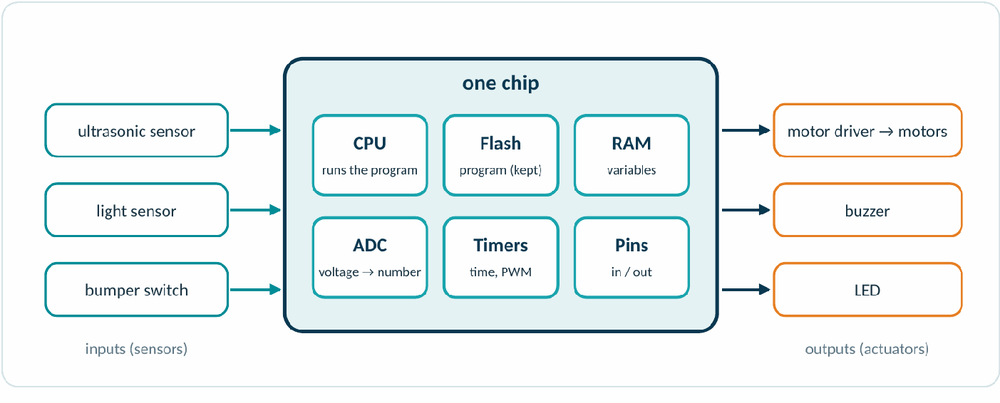

*Figure 1.36 – A microcontroller puts a whole small computer on one chip; the pins connect it to sensors and actuators.*

#### Laptop or microcontroller?

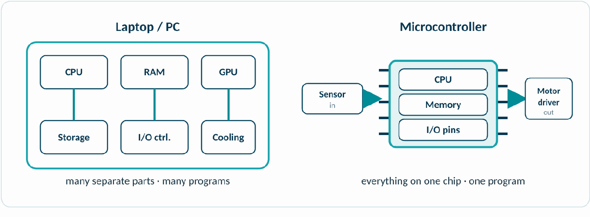

*Figure 1.37 – A laptop compared with a microcontroller.*

| | **Laptop / PC** | **Microcontroller** |
|---|---|---|
| **Purpose** | general-purpose: many different programs | one dedicated program |
| **Parts** | CPU, RAM, storage, GPU and more, as separate parts on a motherboard | CPU, memory and connection pins together on one chip |
| **User interface** | screen, keyboard, mouse | usually none: it talks to the world through sensors and actuators |
| **Memory (example)** | gigabytes of RAM | kilobytes (an Arduino Uno chip has 2 KB of RAM and 32 KB of flash) |
| **Speed (example)** | billions of instructions per second | about 16 million clock cycles per second (Arduino Uno) |
| **Power** | needs a lot | can run on small batteries |
| **Example** | writing an essay | the robot's obstacle-avoiding program |

#### How a microcontroller program is organised

A microcontroller has no operating system that starts and stops different apps. When it is switched on, it starts its one program and never finishes it. Arduino programs make this visible with two parts:

- **setup()** runs **once** when the power comes on. It prepares the hardware, for example "this pin is an output for the motor".
- **loop()** runs **again and again, forever**. This is where the robot senses, decides and acts.

```text
setup():                      # runs once
    make the motor pins outputs
    make the sensor's echo pin an input

loop():                       # repeats forever
    distance = read the ultrasonic sensor (cm)
    if distance > 20:
        drive forward
    otherwise:
        stop, then turn right
```

This is the same idea as the robot program in Section 1.7.5, written in a higher-level language: the JUMP back to the start is hidden inside "loop".

**Common Misconception**

*"A microcontroller is just a weak laptop processor."*

It is not a weaker copy. It is designed for a different job: one task, low power, direct connections to sensors and motors, and reliable timing. A washing machine does not need to run a web browser.

**Check yourself.** (1) Which part of the microcontroller keeps the robot's program when the battery is removed? (2) Which part turns the light sensor's voltage into a number? (3) Which part of the program runs only once?

> ✅ **Check your answers:** [answers to this Check yourself](#answers-check-12).

### 1.7.4. The Sense–Decide–Act Loop

A robot repeats the same three steps over and over:

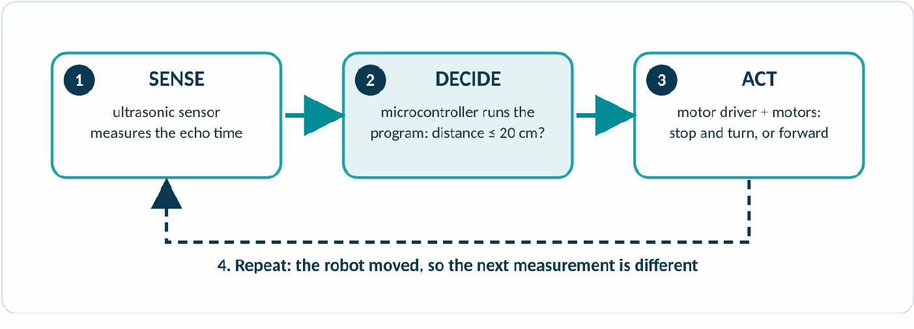

*Figure 1.38 – The sense–decide–act loop: acting changes the world, so the next measurement is different.*

1. **Sense:** the sensor measures.

2. **Decide:** the microcontroller runs its program (fetch–decode–execute again and again) and chooses an action.

3. **Act:** the actuators carry out the action.

4. **Repeat:** acting changes the world, so the next measurement is different.

**How fast is the loop?** For a small robot, one pass might take about 50 milliseconds, so the loop runs about 20 times per second. At 30 cm per second the robot moves only 1.5 cm between decisions, which is why it can react in time.

The simplest kind of response is a **reflex**: a fixed, predetermined reaction to the input. A robot that follows simple rules moment by moment, without building a detailed plan, is called a **reactive robot**. A robot vacuum cleaner works this way. You will meet this idea again in the Behaviorist AI chapter, which also explains what happens when several rules want to control the motors at the same time.

### 1.7.5. Worked Example: The Obstacle-Avoiding Robot

**Setup.** The robot has one ultrasonic sensor at the front, two wheel motors with a motor driver, and a microcontroller. **Rule:** if the wall is 20 cm away or closer, stop and turn; otherwise drive forward.

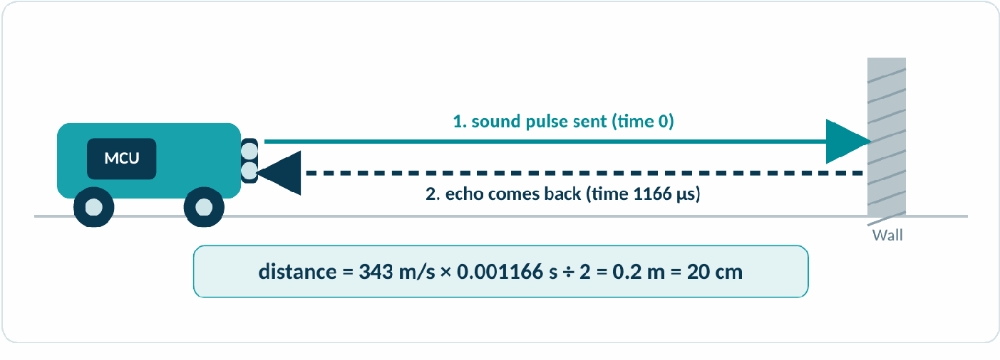

*Figure 1.39 – The sound pulse travels to the wall and back; the echo time gives the distance.*

**Step 1: Sense.** The sensor sends out a short pulse of ultrasound (sound too high for humans to hear) and measures how long the echo takes to come back. Example: **1166 µs** (microseconds; 1 µs = 0.000001 s). Hobby sensors of this kind typically work from a few centimetres up to a few metres.

**Step 2: Calculate.** The speed of sound in air is about **343 m/s** (at around 20 °C).

```text
distance = speed of sound × echo time ÷ 2
         = 343 m/s × 0.001166 s ÷ 2
         = 0.4 m ÷ 2
         = 0.2 m = 20 cm
```

Why ÷ 2? The sound travels to the wall **and back**, so the measured time covers the distance twice.

*Shortcut:* sound travels 34,300 cm per second, so the round trip for 1 cm of distance takes about 58 µs (2 ÷ 34,300 s ≈ 0.000058 s). That gives **distance (cm) = echo time (µs) ÷ 58**. Check: 1166 ÷ 58 = 20.

**Step 3: Decide.** Compare 20 cm with the limit (**threshold**) of 20 cm. The wall is close enough, so the robot must turn.

**Step 4: Act.** The microcontroller stops the motors and turns the robot (left wheel forward, right wheel backward, as in Section 1.7.2).

**The program in plain English.** It looks like the program in Activity 6 "Be the CPU" (Section 1.6.3), but it has no HALT instruction, so it never stops.

| **Address** | **Instruction** |
|---|---|
| **00** | SEND a sound pulse |
| **01** | MEASURE the echo time and put it in Register A (µs) |
| **02** | CALCULATE A ÷ 58 and put the distance (cm) in Register B |
| **03** | IF B is more than 20, JUMP to address 06 |
| **04** | STOP both motors, then TURN right a little |
| **05** | JUMP to address 00 |
| **06** | GO FORWARD |
| **07** | JUMP to address 00 |

A JUMP changes the program counter, so the CPU goes back to address 00 instead of continuing to the next address. That is how the robot repeats forever.

### Activity 11: From Echo to Distance

**Goal:** Calculate distances from echo times and spot a typical mistake.

**Preparation:** Paper, pen and a calculator. Use distance = 343 m/s × time ÷ 2.

**Part A: Calculate**

1. The echo time is 2332 µs. What is the distance?

2. The echo time is 583 µs. What is the distance?

3. Use the shortcut (÷ 58) for an echo time of 2900 µs.

**Part B: Predict**

1. The wall moves twice as far away. What happens to the echo time?

2. The robot should react to walls closer than 30 cm. Roughly which echo time is that?

**Part C: Find the error**

1. A student writes: "Echo time 1166 µs. Distance = 343 × 0.001166 = 0.4 m, so the wall is 40 cm away." What mistake did the student make, and what would the robot do wrongly?

**Observe and reflect:** Why does the program need the conversion from time to distance before it can decide?

> ✅ **Check your answers:** when you have finished, compare your work with the [suggested answers for Activity 11](#answers-activity-11).

### Activity 12: Be the Microcontroller

**Goal:** Trace the robot program and predict what changes if the program or the sensor changes.

**Preparation:** Copy the program table above. Draw a table with the columns Loop, Echo time, Register B, "B more than 20?", Action.

**Part A: Trace.** The sensor gives these echo times in order: 4660, 3500, 1749 and 1166 µs. Use whole-number division (ignore decimals).

1. Fill in the table for loops 1 to 4.

2. Which addresses are executed in loop 1? Which in loop 4?

3. After the turn, the next echo time is 2332 µs. What does the robot do?

**Part B: Predict**

1. The threshold in address 03 is changed from 20 to 30. In which loop does the robot first turn?

2. The sensor is covered by tape and always reports 0 µs. What does the robot do?

3. Address 07 is deleted. What happens after the robot drives forward once?

**Part C: Find the error**

1. A classmate says: "Address 03 makes the robot turn when the wall is *farther* than 20 cm." Is the classmate right?

**Observe and reflect:** Which addresses belong to sensing, deciding and acting?

> ✅ **Check your answers:** when you have finished, compare your work with the [suggested answers for Activity 12](#answers-activity-12).

### Activity 13: Design Challenge: A Parking Sensor

**Goal:** Apply sensors, actuators, thresholds and the sense–decide–act loop to a new device.

**Preparation:** Paper and pen. Work in pairs.

**Task.** Many cars beep when they reverse toward a wall: the closer the wall, the faster the beeps. Design this device for a toy car.

1. Name the sensor, the actuator and the computing part, and say what each does.

2. Write the rules. Use three zones: farther than 100 cm (silent), 30 to 100 cm (slow beeps), closer than 30 cm (fast beeps).

3. Which echo time (µs) matches 100 cm? Which matches 30 cm? Use the ÷ 58 shortcut.

4. Write the program as a setup() part and a loop() part, in plain English.

5. Predict: the readings near 30 cm are noisy (31, 29, 32, 28 cm). What will the driver hear, and how could you make it calmer?

**Observe and reflect:** Which parts of your design are the same as the obstacle-avoiding robot, and which are different?

> ✅ **Check your answers:** when you have finished, compare your work with the [suggested answers for Activity 13](#answers-activity-13).

### Section 1.7 Summary

- A **sensor** measures the world; an **actuator** changes it. Digital sensors give 0 or 1; analog sensors give a range of values.
- A converter turns a smooth signal into numbers by **sampling, quantization and encoding**. More bits give finer **resolution**; a higher **sampling rate** means the robot is "blind" for less time.
- Real readings contain **noise**; averaging a few readings helps, but averaging too many makes the robot slow to react.
- **PWM** controls how much power a motor gets; an **H-bridge** in the **motor driver** controls its direction; two wheels driven differently let the robot steer.
- A **microcontroller** is a tiny computer on one chip (CPU, flash, RAM, pins, ADC, timers) that runs one program: **setup()** once, then **loop()** forever.
- Robots repeat the **sense–decide–act loop**; acting changes what the sensor measures next.
- The obstacle-avoiding robot turns an **echo time** into a **distance** (time × 343 m/s ÷ 2, or µs ÷ 58) and compares it with a **threshold**.

**Back to the starting question:** the robot "knows" about the wall because the ultrasonic sensor times an echo, the microcontroller converts the time into a distance, and a simple rule compares it with 20 cm, about 20 times every second.

## Glossary

The following terms summarize the main concepts introduced in this chapter.

### Computer Components

| **Term** | **Definition** |
|---|---|
| **Hardware** | The physical parts of a computer. |
| **Subsystem** | A group of components with a particular role. |
| **CPU** | The main processing component that executes program instructions. |
| **ALU** | The part of the CPU that performs arithmetic and logic operations. |
| **Control Unit** | Coordinates CPU operations by sending control signals. |
| **Register** | A small and fast storage location inside the CPU. |
| **Data Register** | A register used to temporarily store values needed by the CPU. |
| **Instruction Register** | Holds the instruction currently being processed. |
| **Program Counter** | Holds the address of the next instruction to fetch. |

### Memory and Storage

| **Term** | **Definition** |
|---|---|
| **Main Memory** | Memory used to hold instructions and data needed while programs run. |
| **RAM** | Temporary working memory that normally loses its contents without power. |
| **ROM** | Nonvolatile memory traditionally used for instructions that do not change during normal use. |
| **Cache Memory** | Small and fast memory holding copies of frequently or recently needed information. |
| **Memory Hierarchy** | The organization of memory into different levels based on speed, capacity, and cost. |
| **Memory Address** | A number identifying a memory location. |
| **Bit** | A binary digit, 0 or 1. |
| **Byte** | Eight bits. |
| **Volatile Memory** | Memory that loses its stored information without power. |
| **Nonvolatile Memory** | Memory that can keep information without power. |
| **Secondary Storage** | Hardware that keeps data after power is turned off. |
| **HDD** | A storage device that uses spinning magnetic disks. |
| **SSD** | A storage device that uses flash memory without spinning disks. |

### Operations and Communication

| **Term** | **Definition** |
|---|---|
| **Arithmetic Operations** | Operations used to perform calculations with numbers. |
| **Logic Operations** | Operations that work with bits using rules such as NOT, AND, OR, and XOR. |
| **Shift Operations** | Operations that move bits to the left or right. |
| **Input Device** | Hardware used to send information to a computer. |
| **Output Device** | Hardware used to present results from a computer. |
| **I/O Controller** | Hardware that helps a device communicate with the computer. |
| **Bus** | A communication path between computer components. |
| **Data Bus** | Carries data between components. |
| **Address Bus** | Carries the address of the location or device being accessed. |
| **Control Bus** | Carries signals that coordinate operations, such as reading or writing. |

### Program Execution

| **Term** | **Definition** |
|---|---|
| **Program** | A set of instructions for a computer. |
| **Stored-Program Concept** | The idea that program instructions and data can be stored in memory. |
| **Program Instructions** | Instructions that tell the computer which operations to perform. |
| **Data** | Information that a computer processes or works with. |
| **Fetch** | The process of retrieving an instruction from memory. |
| **Decode** | The process of determining what an instruction requires. |
| **Execute** | The process of carrying out an instruction. |
| **Fetch–Decode–Execute Cycle** | A repeating process through which the CPU follows program instructions. |
| **HALT** | An instruction used to stop program execution. |

### Sensors, Actuators and Microcontrollers

| **Term** | **Definition** |
|---|---|
| **Sensor** | A device that measures something in the physical world and turns it into a signal. |
| **Actuator** | A device that turns a signal into physical action, such as movement or sound. |
| **Digital sensor** | A sensor whose output has only two values, such as pressed (1) or not pressed (0). |
| **Analog sensor / signal** | A sensor or signal that can take any value in a range. |
| **Sampling** | Measuring a signal at regular moments. |
| **Sampling rate** | The number of samples taken per second. |
| **Quantization** | Rounding each sample to the nearest value the converter can store. |
| **Encoding** | Writing a quantized value as a pattern of bits. |
| **Bit depth / resolution** | The number of bits per sample, which decides how many different values can be told apart. |
| **Analog-to-digital converter (ADC)** | The part that turns an analog voltage into a number. |
| **Noise** | Unwanted random variation in sensor readings. |
| **Calibration** | Testing a sensor in its real environment to choose correct limits. |
| **DC motor** | A motor that spins continuously while it gets power. |
| **Servo motor** | A motor that turns to a chosen angle and holds it. |
| **Stepper motor** | A motor that moves in small, exact steps. |
| **PWM (pulse-width modulation)** | Switching a pin on and off quickly so that the average power can be controlled. |
| **Duty cycle** | The fraction of each PWM cycle during which the signal is on. |
| **Motor driver** | A circuit between the microcontroller and a motor that switches the larger motor current. |
| **H-bridge** | A circuit of four switches that lets current flow through a motor in either direction. |
| **Differential drive** | Steering by driving the left and right wheels at different speeds or directions. |
| **Microcontroller** | A tiny computer on one chip, built to run one dedicated program. |
| **Embedded system** | A computer system built into a device with a dedicated task. |
| **GPIO pin** | A general-purpose input/output pin of a microcontroller. |
| **Flash memory** | Non-volatile memory that stores the microcontroller's program. |
| **setup() / loop()** | The part of a microcontroller program that runs once / the part that repeats forever. |
| **Ultrasonic sensor** | A sensor that measures distance by sending a sound pulse and timing its echo. |
| **Echo time** | The time between sending a sound pulse and receiving its echo. |
| **Threshold** | A limit value; the robot reacts when the distance is at or below it. |
| **Reflex action** | A fixed, predetermined response to an input. |
| **Reactive robot** | A robot that follows simple rules moment by moment instead of making detailed plans. |
| **Sense–decide–act loop** | The repeating cycle of measuring, deciding and acting. |

## References

**Textbooks used for this chapter**

- Forouzan, B. A. (2018). *Foundations of Computer Science* (4th ed.). Cengage Learning. Chapter 5, "Computer Organization": central processing unit (p. 92), main memory (p. 94), input/output subsystem (pp. 97–98), connecting I/O devices and controllers (p. 105), subsystem interconnection (p. 104), program execution (p. 109). Data representation: sampling, quantization, encoding and bit rate (pp. 62–63) and analog-to-digital conversion (p. 176).
- Brookshear, J. G. (2011). *Computer Science: An Overview* (11th ed.). Addison-Wesley. Pages 9 (sensors in smartphones), 114 (embedded systems), 462–463 (agents, sensors, actuators, perception, reflex action), 497–499 (robotics, reactive robots).
- von Neumann, J. (2012). *The Computer and the Brain* (3rd ed.). Yale University Press. Foreword to the third edition, p. xx; pp. 57–58 (receptors respond once a minimum intensity, a threshold, is reached).

**Technical documentation**

- Arduino. *Arduino Uno Rev3* product documentation and the `analogWrite()` language reference, docs.arduino.cc. Used for: 10-bit ADC, 2 KB RAM, 32 KB flash, 16 MHz clock, PWM values 0–255 and the recommended pin current (about 20 mA).

**Standard facts used in worked examples:** the speed of sound in air is about 343 m/s at 20 °C; the 58 µs-per-centimetre shortcut is derived from it in Section 1.7.5 (2 ÷ 34,300 s ≈ 58 µs).

**Optional online resources**

- Higginson, P. *Little Man Computer – CPU Simulator*. https://peterhigginson.co.uk/lmc/ (help page: https://peterhigginson.co.uk/lmc/help_new.html). Used in the Optional Interactive Lab in Section 1.6; the paper version of the lab needs no Internet access.

**Figures.** Diagrams in this chapter are simplified teaching models drawn by Team DeepThink for this guide. Figures marked *(illustration)* are photorealistic illustrations that the team added to Study Guide V1.0 to show what the real hardware looks like; they do not show a specific product. Section 1.7 was written by Merey.

## Quiz

*Try the questions without looking back. Then check your answers in the [Answer Key](#quiz-answers) at the end of the chapter.*

### Multiple Choice Questions

**1. Which list shows the three broad categories of subsystems in a computer?**

- **A.** Keyboard, mouse and monitor
- **B.** CPU, Main Memory and the Input/Output subsystem
- **C.** RAM, ROM and cache
- **D.** Data Bus, Address Bus and Control Bus

**2. Which logic operation gives 1 only when both inputs are 1?**

- **A.** NOT
- **B.** OR
- **C.** AND
- **D.** XOR

**3. In the fetch stage, where is the fetched instruction placed?**

- **A.** Program Counter
- **B.** Instruction Register
- **C.** Cache
- **D.** Data Bus

**4. During the decode stage, which component interprets the instruction and decides which operation is required?**

- **A.** ALU
- **B.** Control Unit
- **C.** Program Counter
- **D.** Address Bus

**5. Which order goes from the fastest and smallest memory to the slower and larger one?**

- **A.** RAM → Cache → Registers
- **B.** Cache → Registers → RAM
- **C.** Registers → Cache → RAM
- **D.** Registers → RAM → Cache

**6. Which part of a microcontroller keeps the robot’s program when the battery is removed?**

- **A.** RAM
- **B.** Flash memory
- **C.** Analog-to-digital converter
- **D.** Timers

### True or False Questions

**1. The ALU performs arithmetic, logic and shift operations on data.**

**2. The Program Counter stores the instruction that the CPU is currently processing.**

**3. Eight bits together form one byte.**

**4. ROM is normally volatile, so it loses its contents when the power is turned off.**

**5. A solid-state drive (SSD) stores information magnetically on spinning disks.**

**6. The Address Bus carries information about the memory location the CPU wants to access.**

---

## Answer Key

*Use this key only after you have tried the activity or question yourself. Each heading links back to the place where the task appears.*

### Activity answers

<a id="answers-activity-1"></a>

#### Activity 1: Follow a Keyboard Input

1. Keyboard.

2. RAM.

3. Monitor.

4. The computer could still receive and process information, but the user would not be able to see the result on the screen. Other output methods might still work if available.

[↩ Back to Activity 1](#activity-1-follow-a-keyboard-input)

<a id="answers-activity-2"></a>

#### Activity 2: Understanding CPU Components

**Part A**

1. Instruction Register.

2. ALU.

3. Data Register.

4. Program Counter.

5. Control Unit.

**Part B**

The ALU performs calculations, while the Control Unit coordinates CPU operations. The Program Counter stores the address of the next instruction to fetch.

[↩ Back to Activity 2](#activity-2-understanding-cpu-components)

<a id="answers-activity-3"></a>

#### Activity 3: Memory Detective

1. The CPU receives 9.

2. Addresses 00 and 03 both store 12.

3. No. The address remains 01; only its stored value changes.

4. No. Both 00 and 03 contain 12.

**What to learn:** Addresses identify locations, not the actual contents of those locations.

[↩ Back to Activity 3](#activity-3-memory-detective)

<a id="answers-activity-4"></a>

#### Activity 4: What Happens When Power Is Off?

1. Because unsaved changes may exist only in volatile memory.

2. Because the saved document is stored on a nonvolatile SSD.

3. RAM.

4. Saving a document writes information to nonvolatile storage, while RAM temporarily holds information used by running programs.

Some programs can automatically recover unsaved work, but this should not be taken for granted.

[↩ Back to Activity 4](#activity-4-what-happens-when-power-is-off)

<a id="answers-activity-5"></a>

#### Activity 5: Follow the Data

1. Address Bus.

2. Control Bus.

3. Data Bus.

4. The CPU receives 8.

5. The CPU would receive 12 instead of 8 because address 16 contains a different value.

[↩ Back to Activity 5](#activity-5-follow-the-data)

<a id="answers-activity-6"></a>

#### Activity 6: Be the CPU

**Part A**

1. Register A = 5.

2. Register B = 3.

3. The ALU produces 8.

4. Memory address 20.

5. HALT.

**Part B**

1. The result would become 12 because 5 + 7 = 12.

2. The result would become 2 because 5 - 3 = 2.

3. No. The result would still be stored at memory address 20 because the STORE instruction has not changed.

[↩ Back to Activity 6](#activity-6-be-the-cpu)

<a id="answers-cpu-lab"></a>

#### Optional Interactive Lab: See a CPU Execute Instructions

- After the program is put into memory, boxes 00–07 hold **505, 106, 307, 902, 000, 005, 003, 000**. The first digit is the instruction (5 = LDA, 1 = ADD, 3 = STA, 902 = OUT, 000 = HLT) and the last two digits are the address it uses.
- Step 1 (LDA FIVE): Program Counter 1, accumulator **5**. Step 2 (ADD THREE): Program Counter 2, accumulator **8** – the only step in which the ALU calculates. Step 3 (STA RESULT): Program Counter 3, accumulator 8, memory box **07 changes from 0 to 8**. Step 4 (OUT): Program Counter 4, the OUTPUT box shows **8**. Step 5 (HLT): the program stops.
- With `THREE DAT 7` the output is **12**.
- LDA, STA and OUT only move a value; ADD changes it. Decoding happens inside the control unit every time the simulator reads an instruction number such as 106 and works out that it means "ADD the value at address 06".

*How this lab was checked:* the program and the expected values above were verified with a small LMC emulator in [`tools/verify_content.py`](../tools/verify_content.py) (same memory contents, output 8, value 8 in box 07). The controls STEP, RUN and RESET are the ones named in the simulator's help page (https://peterhigginson.co.uk/lmc/help_new.html).

[↩ Back to Optional Interactive Lab: See a CPU Execute Instructions](#optional-interactive-lab-see-a-cpu-execute-instructions)

<a id="answers-activity-7"></a>

#### Activity 7: Round It Like a Converter

1. 0, 2, 6, 7, 3.

2. 000, 010, 110, 111, 011.

3. Yes. 1.8 rounds to 2, so it also gets 010. The small difference between 1.8 and 2.2 is lost.

4. 4 bits give 2⁴ = 16 values, so the steps are finer and the rounding error is smaller.

5. Bit rate = samples per second × bits per sample = 10 × 3 = 30 bits per second.

**What to learn:** both steps lose information. Sampling skips what happens between samples, and quantization rounds each value.

[↩ Back to Activity 7](#activity-7-round-it-like-a-converter)

<a id="answers-activity-8"></a>

#### Activity 8: Fast Enough? Sampling and Noise

1. 30 cm/s ÷ 5 readings per second = 6 cm between readings.

2. The robot drives 30 cm between readings. A wall that was 40 cm away at one reading can be only 10 cm away at the next, so the robot may react too late or hit the wall.

3. 34 cm. The robot is not moving, and all the other readings are close to 20 cm.

4. (34 + 19 + 20) ÷ 3 = 73 ÷ 3 ≈ 24.3 cm.

5. (20 + 21 + 34 + 19 + 20) ÷ 5 = 114 ÷ 5 = 22.8 cm.

6. 100 readings at 20 per second take 5 seconds. The average then describes where the wall was over the last 5 seconds, and a robot driving at 30 cm/s covers 150 cm in that time. The reading would be steady but badly out of date.

**What to learn:** averaging a few readings removes noise; averaging too many makes the robot react to the past instead of the present.

[↩ Back to Activity 8](#activity-8-fast-enough-sampling-and-noise)

<a id="answers-activity-9"></a>

#### Activity 9: Sensor or Actuator?

1. Labels: 1 S, 2 A, 3 S, 4 A, 5 S, 6 A, 7 S, 8 B (it shows images and also senses touch), 9 A, 10 S.

2. No. The camera produces signals and the wheels can turn, but nothing decides what the wheels should do. A microcontroller (or another processor) running a program is needed in the middle.

**What to learn:** a useful question is "Does it *measure* the world, or *change* it?"

[↩ Back to Activity 9](#activity-9-sensor-or-actuator)

<a id="answers-activity-10"></a>

#### Activity 10: Drive the Motors

1. 0.5 × 6 V = 3 V.

2. 0.75 × 6 V = 4.5 V.

3. About 64, because 0.25 × 255 ≈ 64.

4. The left wheel turns forward and the right wheel turns backward, so the robot spins on the spot to the right.

5. To the right. The left wheel travels faster than the right wheel, so the robot turns toward the slower side.

6. The pin cannot supply the large current the motor needs. The motor gets too little power to turn, and the attempt can overload the pin and disturb the microcontroller's power supply, which makes it restart. A motor driver must switch the battery current instead.

**What to learn:** PWM controls the amount of power, the H-bridge controls its direction, and the motor driver keeps the large current away from the microcontroller.

[↩ Back to Activity 10](#activity-10-drive-the-motors)

<a id="answers-check-12"></a>

#### Check yourself – 1.7.3. Microcontrollers: The Tiny Computer Inside a Machine

(1) flash memory; (2) the analog-to-digital converter; (3) setup().

[↩ Back to 1.7.3. Microcontrollers: The Tiny Computer Inside a Machine](#173-microcontrollers-the-tiny-computer-inside-a-machine)

<a id="answers-activity-11"></a>

#### Activity 11: From Echo to Distance

1. 343 × 0.002332 = 0.8 m, and 0.8 ÷ 2 = 0.4 m = **40 cm**.

2. 343 × 0.000583 = 0.2 m, and 0.2 ÷ 2 = 0.1 m = **10 cm**.

3. 2900 ÷ 58 = **50 cm** (the exact formula gives about 49.7 cm).

4. The echo time doubles, because the sound has to travel twice the distance.

5. About 30 × 58 = 1740 µs (the exact formula gives about 1749 µs), so roughly 1750 µs.

6. The student forgot to divide by 2. The real distance is 20 cm. The robot would think the wall is 40 cm away, keep driving forward, and turn only when the wall is really about 10 cm away, which may be too late.

**What to learn:** the threshold (20 cm) is a distance, but the sensor gives a time, so the units must be converted first.

[↩ Back to Activity 11](#activity-11-from-echo-to-distance)

<a id="answers-activity-12"></a>

#### Activity 12: Be the Microcontroller

1. Loop 1: 4660 ÷ 58 = 80, more than 20, forward. Loop 2: 3500 ÷ 58 = 60, forward. Loop 3: 1749 ÷ 58 = 30, forward. Loop 4: 1166 ÷ 58 = 20, not more than 20, stop and turn.

2. Loop 1: 00, 01, 02, 03, 06, 07. Loop 4: 00, 01, 02, 03, 04, 05.

3. 2332 ÷ 58 = 40, more than 20, so it drives forward.

4. Loop 3: B = 30 is not more than 30, so the robot turns.

5. B = 0 is not more than 20, so the robot turns in every loop and never drives forward. It is safe but useless.

6. The program counter moves past the last instruction and nothing sends it back to 00, so the robot stops checking after one pass and no longer reacts.

7. No. If B is *more* than 20, the JUMP skips the turn and goes forward. The robot turns when B is 20 or less.

**What to learn:** addresses 00–01 sense, 02–03 decide, 04 and 06 act, and 05 and 07 repeat the loop.

[↩ Back to Activity 12](#activity-12-be-the-microcontroller)

<a id="answers-activity-13"></a>

#### Activity 13: Design Challenge: A Parking Sensor

1. Sensor: an ultrasonic sensor measures the distance behind the car. Computing part: a microcontroller converts the echo time to a distance and applies the rules. Actuator: a buzzer makes the beeps.

2. IF distance > 100 cm THEN silent. IF distance is from 30 to 100 cm THEN slow beeps. IF distance < 30 cm THEN fast beeps.

3. 100 cm × 58 = 5800 µs; 30 cm × 58 = 1740 µs.

4. setup(): make the buzzer pin an output and prepare the sensor pins. loop(): measure the echo time, divide by 58, choose the zone with the rules, beep at the matching speed, and repeat.

5. The beeping would keep switching between slow and fast, which is confusing. Average a few readings, or use two limits (enter "fast" below 30 cm, leave it only above 35 cm), as in the hysteresis idea of the Behaviorist AI chapter.

**What to learn:** the same pattern (sensor → number → rule → actuator, repeated) solves many different problems. Only the sensor, the rules and the actuator change.

[↩ Back to Activity 13](#activity-13-design-challenge-a-parking-sensor)

### Quiz answers

| Part | Question | Answer | Why |
|---|---|---|---|
| Multiple choice | 1. Which list shows the three broad categories of subsystems in a computer? | **B** |  |
| Multiple choice | 2. Which logic operation gives 1 only when both inputs are 1? | **C** |  |
| Multiple choice | 3. In the fetch stage, where is the fetched instruction placed? | **B** |  |
| Multiple choice | 4. During the decode stage, which component interprets the instruction and decides which operation is required? | **B** |  |
| Multiple choice | 5. Which order goes from the fastest and smallest memory to the slower and larger one? | **C** |  |
| Multiple choice | 6. Which part of a microcontroller keeps the robot’s program when the battery is removed? | **B** |  |
| True / False | 1. The ALU performs arithmetic, logic and shift operations on data. | **True** |  |
| True / False | 2. The Program Counter stores the instruction that the CPU is currently processing. | **False** | The Program Counter holds the *address of the next* instruction; the instruction being processed is in the Instruction Register. |
| True / False | 3. Eight bits together form one byte. | **True** |  |
| True / False | 4. ROM is normally volatile, so it loses its contents when the power is turned off. | **False** | ROM is nonvolatile and keeps its contents without power; RAM is the memory that is normally volatile. |
| True / False | 5. A solid-state drive (SSD) stores information magnetically on spinning disks. | **False** | An SSD stores data in flash memory and has no moving parts; an HDD uses spinning magnetic disks. |
| True / False | 6. The Address Bus carries information about the memory location the CPU wants to access. | **True** |  |

---

[🏠 Start here](00-Start-Here.md) · [Chapter 2: Networks →](02-Networks.md)
