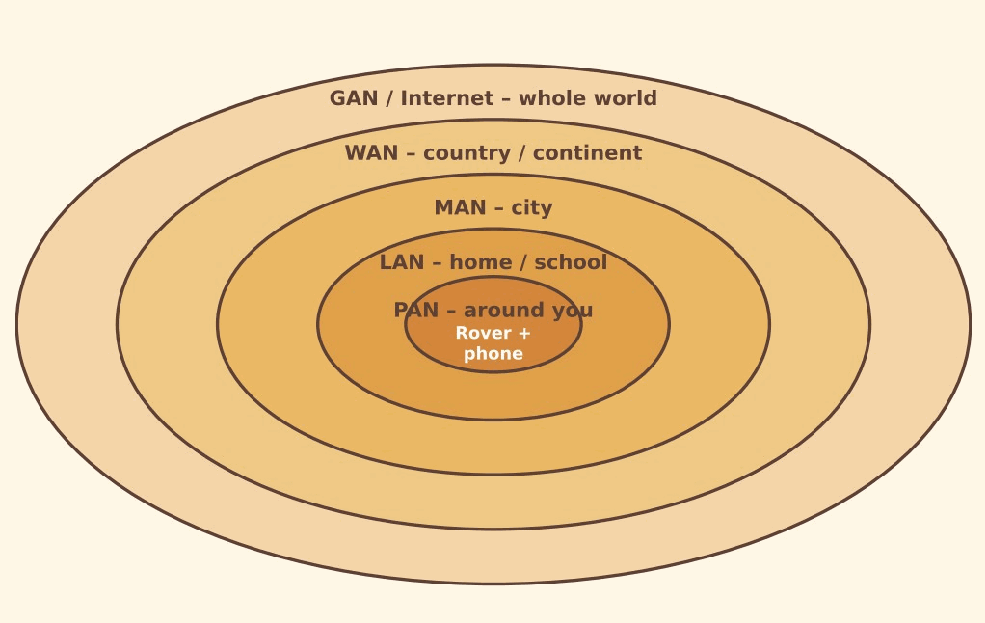
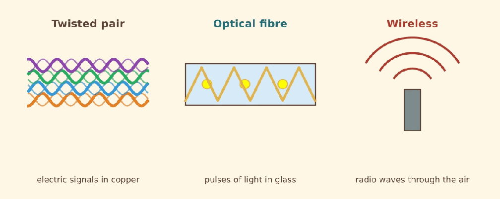
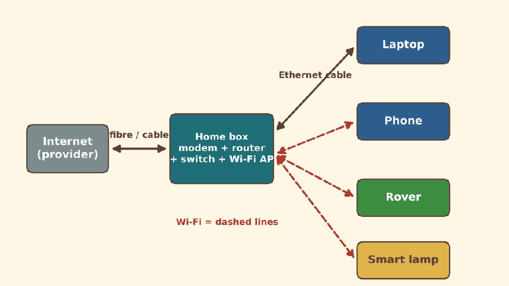
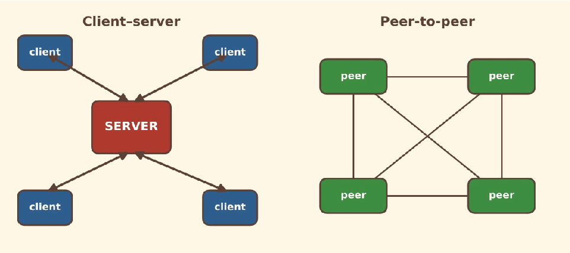
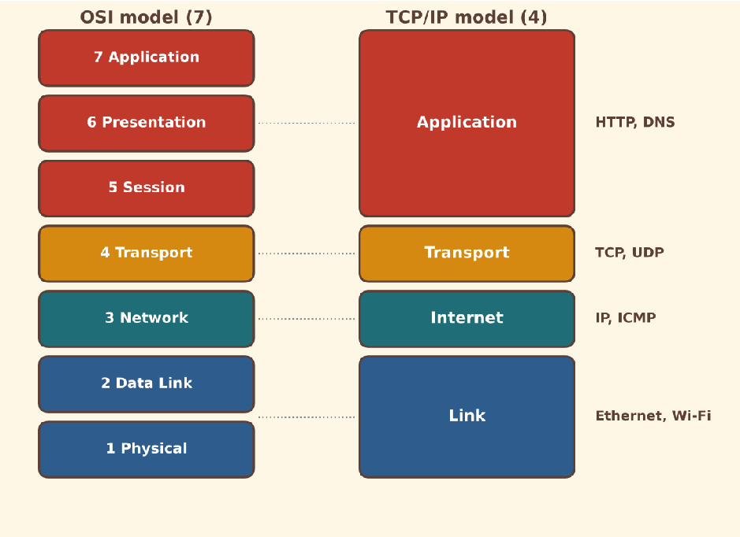
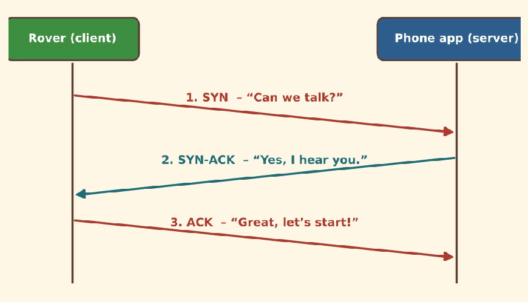
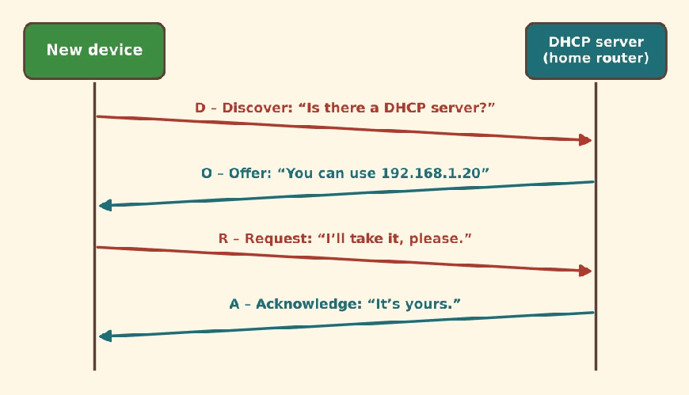
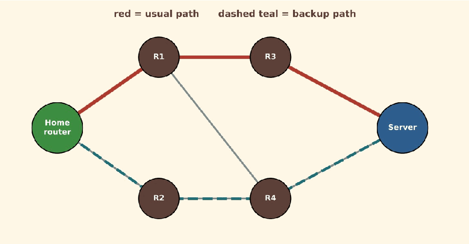
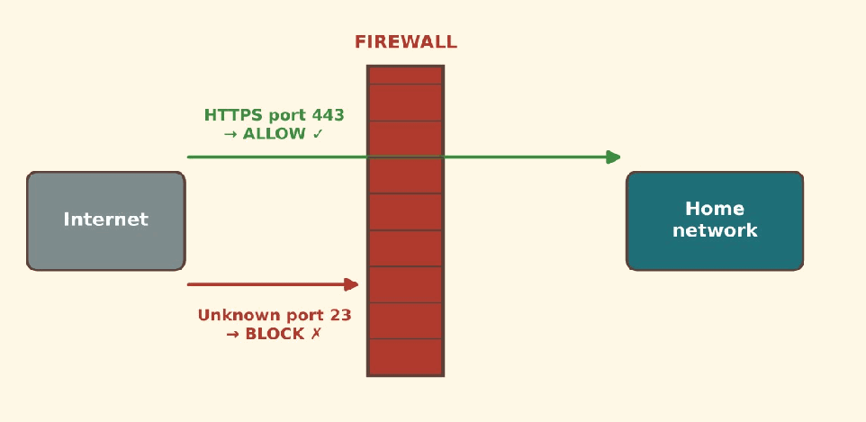
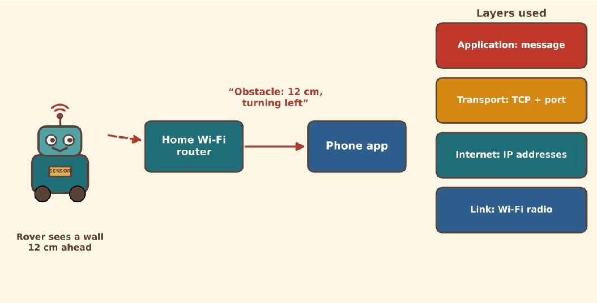

[← Chapter 1: Hardware](01-Hardware.md) · [🏠 Start here](00-Start-Here.md) · [Chapter 3: Behaviorist AI →](03-Behaviorist-AI.md)

# Chapter 2. Networks

*How devices talk to each other*

**Contents**

- [Before You Start](#before-you-start)
  - [What you will learn](#what-you-will-learn)
  - [What you need to know already](#what-you-need-to-know-already)
  - [How to use this chapter](#how-to-use-this-chapter)
- [2.1. Network Fundamentals](#21-network-fundamentals)
  - [2.1.1. Types of networks](#211-types-of-networks)
  - [2.1.2. Networking media](#212-networking-media)
  - [2.1.3. Networking devices](#213-networking-devices)
- [2.2. Network Architecture](#22-network-architecture)
  - [Layers: dividing a big job into small jobs](#layers-dividing-a-big-job-into-small-jobs)
- [2.3. Internet Infrastructure](#23-internet-infrastructure)
  - [2.3.1. What is the Internet?](#231-what-is-the-internet)
  - [2.3.2. Core protocols](#232-core-protocols)
  - [2.3.3. Internet addressing](#233-internet-addressing)
  - [2.3.4. Domains](#234-domains)
  - [2.3.5. Routing](#235-routing)
  - [2.3.6. Servers](#236-servers)
  - [Network Lab: Look at a Real Network from Your Own Computer](#network-lab-look-at-a-real-network-from-your-own-computer)
- [2.4. Security](#24-security)
  - [2.4.1. Firewalls](#241-firewalls)
  - [2.4.2. Privacy](#242-privacy)
  - [2.4.3. Authentication](#243-authentication)
  - [2.4.4. Integrity](#244-integrity)
  - [2.4.5. Non-repudiation](#245-non-repudiation)
- [2.5. Why Networking Matters](#25-why-networking-matters)
  - [Mission complete: Rover’s message](#mission-complete-rovers-message)
- [Chapter summary](#chapter-summary)
- [Glossary](#glossary)
- [References](#references)
- [Quiz](#quiz)
  - [Multiple Choice Questions](#multiple-choice-questions)
  - [True or False Questions](#true-or-false-questions)
- [Answer Key](#answer-key)
  - [Quick check answers](#quick-check-answers)
  - [Network Lab: expected results](#network-lab-expected-results)
  - [Quiz answers](#quiz-answers)

---

## Before You Start

### What you will learn

- What a network is, and the main types of networks.
- How data travels through cables, glass fibre and the air.
- What switches, routers, access points and modems do.
- How the OSI and TCP/IP models split communication into layers.
- How the Internet works: protocols, IP addresses, domains, routing and servers.
- The five basic ideas of network security.

### What you need to know already

Nothing special. You only need to know that computers, phones and robots are electronic devices. Every new word is explained before it is used, and the glossary at the end repeats the key terms.

### How to use this chapter

| **Step** | **What to do** | **Why** |
|---|---|---|
| 1. Read | Read one short section. | Learn one idea at a time. |
| 2. Look | Study the picture next to it. | Pictures make invisible processes visible. |
| 3. Check | Answer the Quick check without looking back. | Use the idea instead of only reading it. |
| 4. Compare | Compare your answer with the Answer Key at the end of the chapter. | Find what you still need to review. |

**✏ Mission question – make a prediction**

You send a message from your phone to a friend in another city, and it arrives in one second. **How does it find the right phone?** Write your guess in two or three sentences. Keep it: you will check it at the end of the chapter.

## 2.1. Network Fundamentals

A **network** is two or more devices connected so that they can exchange information and share resources, such as an Internet connection, files or a printer. Without a network, every device is alone, like an island.

🤖 **Rover says…**

Right now I am an island. I can see the wall, but nobody knows about it!

### 2.1.1. Types of networks

#### A. By size (geographical coverage)

*Figure 2.1 – Network types from the smallest to the largest.*

| **Type** | **Size** | **Example** | **Typical connection** |
|---|---|---|---|
| **PAN** – Personal Area Network | A few metres around one person | Phone + wireless earbuds or smartwatch | Bluetooth, USB |
| **LAN** – Local Area Network | A room, building or small campus | Home Wi-Fi, a school computer lab | Ethernet, Wi-Fi |
| **MAN** – Metropolitan Area Network | A city | Several university buildings in one city | Fibre |
| **WAN** – Wide Area Network | A country or continent | A bank connecting branches in many cities | Fibre, leased lines |
| **GAN** – Global Area Network | The whole world | A global company network; the Internet is the largest example | Undersea cables, satellites |

#### B. By ownership

- **Private network** – owned and used by one person or organisation, with limited access (a company LAN).
- **Public network** – open to many users (public Wi-Fi in a café, a mobile network).

#### C. By role

- **Client–server** – central servers provide services to many clients. Organised and easier to secure.
- **Peer-to-peer (P2P)** – devices share directly with each other, without a central server. Simple and cheap, but harder to control.

#### D. By transmission

- **Wired** – cables. Usually faster and more stable, but devices cannot move freely.
- **Wireless** – radio waves. Flexible and mobile, but walls and other devices can disturb the signal.

**✔ Quick check 1 – Network types**

Which type is each one? (a) earbuds connected to your phone; (b) the Wi-Fi in your dormitory; (c) a network linking all libraries of one city; (d) a company linking offices in Beijing and Tashkent; (e) Rover on your home Wi-Fi.

> ✅ **Check your answer:** [answer to Quick check 1 – Network types](#answers-qc-1).

### 2.1.2. Networking media

A **transmission medium** is the path that carries the signal from one device to another.

*Figure 2.2 – Three ways to carry data: electricity, light and radio waves.*

#### A. Guided media (wired)

- **Twisted-pair cable** – pairs of copper wires twisted together to reduce noise. The usual Ethernet cable in homes and offices.
- **Coaxial cable** – one central copper wire with insulation and a shield around it. Used for cable TV and some Internet connections.
- **Fibre-optic cable** – thin glass or plastic threads that carry pulses of light. Very fast and good for long distances.

#### B. Unguided media (wireless)

- **Radio waves** – Wi-Fi, Bluetooth and mobile networks.
- **Microwaves** – high-frequency radio waves for point-to-point and satellite links.
- **Infrared** – very short range and needs a clear line of sight, like a TV remote.
- **Satellite** – signals sent through satellites for places far from cables.

**✔ Quick check 2 – Networking media**

Which medium fits best? (a) a desktop PC next to the router; (b) Rover, which moves around the room; (c) a link between two cities 300 km apart; (d) a TV remote control.

> ✅ **Check your answer:** [answer to Quick check 2 – Networking media](#answers-qc-2).

### 2.1.3. Networking devices

#### A. End devices

End devices are the devices people use: PCs, laptops, smartphones, smart TVs, network printers – and Rover.

#### B. Interconnection devices

| **Device** | **Layer (OSI)** | **What it does** |
|---|---|---|
| **Hub** | Layer 1 – Physical | Connects devices and copies incoming data to **all** ports. Simple, no intelligence; rarely used today. |
| **Switch** | Layer 2 – Data Link | Connects devices in one LAN and sends data **only** to the right port, using MAC addresses. |
| **Router** | Layer 3 – Network | Connects **different** networks (your home and the Internet) and forwards packets using IP addresses. |
| **Access point (AP)** | Layer 2 | Lets wireless devices join the wired network through Wi-Fi. |
| **Modem** | Layer 1 | Converts signals between your network and the provider’s line (phone, cable or fibre). |

*Figure 2.3 – A home network. At home, one box often contains the modem, router, switch and access point.*

**✔ Quick check 3 – Networking devices**

Name the device: (a) “I send data only to the port where the receiver is.” (b) “I connect your home network to the Internet.” (c) “I copy everything to every port.” (d) “I let phones join without a cable.” (e) “I convert signals for the provider’s line.”

> ✅ **Check your answer:** [answer to Quick check 3 – Networking devices](#answers-qc-3).

## 2.2. Network Architecture

**Network architecture** describes how a network is organised: who asks, who answers, and how the work of sending data is divided.

*Figure 2.4 – Client–server compared with peer-to-peer.*

### Layers: dividing a big job into small jobs

Sending a message is a big job: create the message, cut it into pieces, add addresses, and send signals through a cable or the air. Engineers divide this work into **layers**. Each layer does one job and passes the result to the next layer. It is like posting a parcel: you pack it, the post office labels it, trucks move it, and the receiver unpacks it.

#### The OSI model (7 layers)

The **OSI model** (Open Systems Interconnection) is a conceptual model with seven layers. It is mainly used for learning and for describing where a problem happens.

| **Layer** | **Job** |
|---|---|
| 7. Application | Services for programs and users (web, email). |
| 6. Presentation | Formats data: encoding, compression, encryption. |
| 5. Session | Starts, keeps and ends a conversation (session). |
| 4. Transport | Delivers data between programs; splits it into segments; checks errors. |
| 3. Network | Logical (IP) addressing and routing between networks. |
| 2. Data Link | Delivery inside one local network using MAC addresses. |
| 1. Physical | Sends raw bits (0 and 1) as electricity, light or radio. |

#### The TCP/IP model (4 layers)

The Internet really works with the simpler **TCP/IP model**. Its four layers combine some OSI layers, as the picture shows.

*Figure 2.5 – How the 7 OSI layers match the 4 TCP/IP layers.*

🧠 **Memory trick for OSI (from 1 to 7)**

**P**lease **D**o **N**ot **T**hrow **S**ausage **P**izza **A**way = Physical, Data Link, Network, Transport, Session, Presentation, Application.

**✔ Quick check 4 – Layers**

Put each item on its TCP/IP layer: HTTP, Wi-Fi, TCP, IP, DNS, UDP, Ethernet cable, ICMP.

Why is it useful that Wi-Fi and HTTP are on different layers?

> ✅ **Check your answer:** [answer to Quick check 4 – Layers](#answers-qc-4).

## 2.3. Internet Infrastructure

### 2.3.1. What is the Internet?

The **Internet** is a global **network of networks**. Millions of private, public, university, business and government networks are connected so that their devices can communicate. It is not one big computer – it is routers, servers, cables, satellites and shared rules (protocols) working together.

| **Element** | **Role** |
|---|---|
| Clients | Phones, laptops and PCs that ask for services. |
| Servers | Computers that store and provide websites, files, email and apps. |
| Protocols | Shared rules: TCP/IP, DNS, HTTP/HTTPS, email protocols (SMTP, IMAP, POP3). |
| Routers | Move packets from one network to the next, like a postal system. |
| IP addresses | Numbers that identify devices so data can find them. |
| Physical infrastructure | Fibre and undersea cables, satellites, mobile towers, data centres. |

#### Internet vs. World Wide Web

- **Internet** = the whole infrastructure (cables, routers, servers, protocols) – like the roads.
- **World Wide Web (WWW)** = one service on the Internet that delivers web pages through HTTP/HTTPS – like the shops along the roads.
- Other Internet services: email, video calls, online games, cloud storage – and Rover’s reports.

**✔ Quick check**

Is a WhatsApp or WeChat voice call part of the Web?

> ✅ **Check your answer:** [answer to Quick check](#answers-qc-5).

### 2.3.2. Core protocols

A **protocol** is a set of rules that both sides agree on, so devices made by different companies can understand each other.

| **Protocol** | **Layer (TCP/IP)** | **Main job** |
|---|---|---|
| **IP** – Internet Protocol | Internet | Gives logical addresses and moves packets from the sender to the receiver across networks. Versions: IPv4 (32-bit) and IPv6 (128-bit). |
| **TCP** – Transmission Control Protocol | Transport | Connection-oriented and reliable: starts with a handshake, numbers the data, checks errors, resends lost pieces and puts them back in order. |
| **UDP** – User Datagram Protocol | Transport | Connectionless and fast: no handshake and no resending. Good when speed matters more than every piece (live video, games). |
| **ICMP** – Internet Control Message Protocol | Internet | Reports errors and status (for example, “destination unreachable”). The ping tool uses ICMP messages. |
| **ARP** – Address Resolution Protocol | Between Link and Internet | Finds the MAC address of a device on the same LAN when only its IP address is known. |

#### TCP’s three-way handshake

Before TCP sends data, the two devices agree to talk. It works like the start of a phone call:

*Figure 2.6 – The TCP three-way handshake: SYN → SYN-ACK → ACK.*

#### Packets

A long message is not sent in one piece. It is cut into small **packets**. Each packet has a **header** (sender address, receiver address, number) and a piece of the data. Packets can take different paths, and if one is lost, only that one is sent again. (More precisely, TCP calls its pieces “segments”, and IP carries them in packets.)

**✔ Quick check 5 – Protocols and packets**

(a) Rover’s report is split into 5 numbered packets, and packet 3 is lost. Which protocol notices and asks for it again: TCP or UDP?

(b) Which protocol is better for a live video call where speed matters most?

(c) What are the three messages of the TCP handshake?

> ✅ **Check your answer:** [answer to Quick check 5 – Protocols and packets](#answers-qc-6).

### 2.3.3. Internet addressing

An **IP address** is a number that identifies a device on a network, like a home address for your device. It has two jobs: **identification** (who is sending or receiving) and **location** (helping routers know where to forward packets).

| **Version** | **Example** | **Key point** |
|---|---|---|
| IPv4 | 192.168.1.20 | Four numbers from 0 to 255, separated by dots (32 bits). About 4.3 billion addresses – not enough today. |
| IPv6 | 2001:db8::20 | 128 bits, written in hexadecimal. A huge number of addresses. |

#### Private and public addresses

Some IPv4 ranges are reserved for **private** networks such as homes and schools: **10.x.x.x**, **172.16.x.x – 172.31.x.x** and **192.168.x.x**. These addresses work only inside the local network, so millions of homes can use the same ones. A **public** address is used on the Internet.

#### Static and dynamic addresses

- **Static IP** – set by hand and does not change. Good for servers and printers.
- **Dynamic IP** – given automatically by a **DHCP** server and may change over time. Normal for phones and laptops.

#### DHCP – Dynamic Host Configuration Protocol

DHCP automatically gives a device an IP address and other settings (subnet mask, default gateway, DNS server). This avoids mistakes such as two devices using the same address. The process has four steps, called **DORA**:

*Figure 2.7 – DHCP in four steps: Discover, Offer, Request, Acknowledge.*

**✔ Quick check 6 – IP addresses**

Write private, public or invalid: (a) 192.168.1.20; (b) 10.0.0.5; (c) 8.8.8.8; (d) 192.168.1.300; (e) 172.20.4.1; (f) 172.40.4.1.

What do the letters DORA mean in DHCP?

> ✅ **Check your answer:** [answer to Quick check 6 – IP addresses](#answers-qc-7).

### 2.3.4. Domains

A **domain name** is a human-friendly name for a website or other Internet resource, such as example.com. People remember names more easily than numbers.

*Figure 2.8 – The parts of a web address.*

- **Top-level domain (TLD)** – the last part: .com, .org, .net, .cn, .uz.
- **Second-level domain** – the name chosen by the owner: “example” in example.com.
- **Subdomain** – an optional part in front: www.example.com or mail.example.com. “www” is a subdomain that traditionally marks a website.

#### DNS – Domain Name System

**DNS** works like a phone book: it translates a domain name into the IP address that computers need. When you type a name, your device asks a DNS server, receives the IP address, and then contacts the web server.

**✔ Quick check 7 – Domains and DNS**

Split https://mail.google.com into protocol, subdomain, second-level domain and TLD.

What does DNS give your computer?

> ✅ **Check your answer:** [answer to Quick check 7 – Domains and DNS](#answers-qc-8).

### 2.3.5. Routing

**Routing** is choosing the path that packets take from the sender to the receiver across networks. Each router reads the destination IP address, checks its **routing table** (a list of possible paths) and sends the packet to the **next hop** – the next router. This repeats, hop by hop, until the packet arrives.

*Figure 2.9 – Packets travel hop by hop. If one router fails, a backup path can be used.*

- **Static routing** – paths are set by hand by an administrator. Simple, but it does not adapt when the network changes.
- **Dynamic routing** – routers share information and update paths automatically, using protocols such as **RIP** (counts hops), **OSPF** (compares cost or speed) and **BGP** (connects large networks on the Internet).

Good routing gives **speed** (a good path), **reliability** (another path if one fails) and **scalability** (billions of devices).

**✔ Quick check 8 – Routing**

Look at Figure 2.9. (a) How many hops are on the red path from the home router to the server? (b) Router R3 breaks – write a new path.

What is the difference between static and dynamic routing?

> ✅ **Check your answer:** [answer to Quick check 8 – Routing](#answers-qc-9).

### 2.3.6. Servers

A **server** is a computer (often more powerful than a normal PC and running all the time) that provides services or data to other computers, called **clients**. “Client” and “server” are roles: even Rover’s phone app acts as a server when it receives Rover’s reports.

| **Server type** | **What it does** | **Example** |
|---|---|---|
| Web server | Sends web pages (HTTP port 80, HTTPS port 443). | Nginx, Apache |
| Application server | Runs the program logic behind an app. | Node.js, Tomcat |
| Database server | Stores organised data for a long time. | MySQL, PostgreSQL, MongoDB |
| Cache server | Keeps often-used data in fast memory. | Redis, Memcached |
| Streaming server | Sends audio and video streams. | Video platforms |
| Game server | Keeps multiplayer games in sync in real time. | Online game servers |
| Backup server | Stores copies of data for recovery. | Daily or weekly backups |

**🔗 Putting it together**

**Domain** = the name (example.com) · **DNS** = the phone book that finds the IP · **Routing** = the GPS that finds the path · **Server** = the house where the website lives.

**✔ Quick check 9 – Servers**

Which server type is used when: (a) you open a news website; (b) your exam marks are stored; (c) you watch a live stream; (d) you play an online match; (e) files are restored after a computer breaks?

> ✅ **Check your answer:** [answer to Quick check 9 – Servers](#answers-qc-10).

### Network Lab: Look at a Real Network from Your Own Computer

**Goal:** See IP addresses, DNS, packets and routing on a real network instead of only on paper.

**Preparation:** A Windows, macOS or Linux computer connected to the Internet (about 20 minutes). You can use any website that opens on your network instead of www.baidu.com. You type each command in a terminal: on Windows open **Command Prompt** (press Win + R, type `cmd`, press Enter); on macOS or Linux open **Terminal**. The commands only *read* information; they do not change any settings. If the computer lab blocks some commands, use the expected results in the answer key as a paper version.

**Task**

| Step | Windows | macOS / Linux | What to look for |
|---|---|---|---|
| 1. Your own address | `ipconfig` | `ipconfig getifaddr en0` (macOS) or `ip addr` (Linux) | Your IPv4 address and the **default gateway** (your router). |
| 2. Ask DNS | `nslookup www.baidu.com` | `nslookup www.baidu.com` | The IP address that DNS returns for the name. |
| 3. Test the path | `ping -n 4 www.baidu.com` | `ping -c 4 www.baidu.com` | Whether replies come back, and the **time** in milliseconds. |
| 4. Count the hops | `tracert www.baidu.com` | `traceroute www.baidu.com` (on Linux you may first need to install `traceroute`) | One line for each router (hop) on the way. |

1. **Predict first:** Will your IPv4 address be private or public? About how many routers do you think lie between you and the server?
2. Run the four commands and write down: your IPv4 address, the default gateway, the IP address of the website, the average ping time and the number of hops.
3. Is your IPv4 address in a private range (10.x.x.x, 172.16–172.31.x.x or 192.168.x.x)? What does that tell you about the router?
4. Which command uses **ICMP**, and which one uses **DNS**?
5. Use your ping time to calculate how far Rover (0.3 m/s) would drive while one message travels to the server and back.

**Observe and reflect:** Which step of Rover's message (Section 2.5) did each command show you?

> ✅ **Check your answers:** compare your results with the [expected results for the Network Lab](#answers-network-lab).

## 2.4. Security

**Network security** protects data, devices and connections from unauthorised access, changes and attacks. Rover’s report travels through the air – so how do we keep it safe?

### 2.4.1. Firewalls

A **firewall** is hardware or software that checks incoming and outgoing traffic and allows or blocks it using **rules**. It works like a guard at the door with a list.

*Figure 2.10 – A firewall allows traffic that matches a rule and blocks the rest.*

- **Packet-filtering firewall** – checks addresses and ports (Layers 3–4).
- **Stateful firewall** – remembers connections and allows only packets that belong to them.
- **Application-layer firewall (proxy)** – checks the content of specific applications, such as HTTP.
- **Next-generation firewall (NGFW)** – combines the above with intrusion prevention and deep inspection.

### 2.4.2. Privacy

**Privacy (confidentiality)** means only the right people can read the data. Main tools: **encryption** (data is scrambled; HTTPS uses TLS), **access control** (only authorised users see data) and **anonymisation** (removing personal details from data sets). HTTP is like a postcard anyone can read; HTTPS is like a sealed envelope.

### 2.4.3. Authentication

**Authentication** checks that a user or device is who it claims to be.

- **Something you know** – password, PIN.
- **Something you have** – phone code, security key.
- **Something you are** – fingerprint, face.

Using two or more of these is **multi-factor authentication (MFA)**. Devices and websites can also prove identity with **digital certificates**, and programs often use **tokens or API keys**.

### 2.4.4. Integrity

**Integrity** means the data was not changed on the way or in storage. **Checksums and hashes** (for example SHA-256) act like a fingerprint of the data: if one character changes, the fingerprint changes. **Digital signatures** also protect integrity.

### 2.4.5. Non-repudiation

**Non-repudiation** means a sender cannot later deny sending a message or doing an action. It is achieved with **digital signatures** (only the owner of the private key can create them) and secure **audit logs**.

| **Idea** | **Protects against** | **Example** |
|---|---|---|
| Firewall | Unwanted traffic | Block unknown ports |
| Privacy | Others reading data | HTTPS padlock |
| Authentication | Fake users or devices | Password + phone code |
| Integrity | Data being changed | Hash check |
| Non-repudiation | Denying an action | Digital signature |

**✔ Quick check 10 – Security**

Rover sends “Obstacle: 12 cm, turning left”. Which idea helps? (a) A stranger reads the report. (b) Someone changes “12 cm” to “2 cm”. (c) A fake device pretends to be Rover. (d) Rover later denies sending the report. (e) An unknown computer tries to connect on a strange port.

> ✅ **Check your answer:** [answer to Quick check 10 – Security](#answers-qc-11).

## 2.5. Why Networking Matters

Networking connects devices, systems and people. Without it there would be no Internet, no cloud services, no online learning and no connected robots.

- **Connectivity** – devices can exchange information anywhere in the world.
- **Speed** – fast transfer makes video, games and AI services possible.
- **Reliability** – routing and protocols help data arrive correctly.
- **Collaboration** – cloud computing and many machines working together.

### Mission complete: Rover’s message

*Figure 2.11 – Rover’s report travels through the four TCP/IP layers to the phone.*

| **Step** | **Layer** | **What happens** |
|---|---|---|
| 1 | Application | Rover’s program creates the report and sends it to the phone app (HTTPS). |
| 2 | Transport | TCP does the handshake, numbers the data and adds the port number of the app. |
| 3 | Internet | IP adds the addresses: Rover 192.168.1.20 → phone 192.168.1.35. |
| 4 | Link | Rover’s Wi-Fi module sends radio signals to the access point. |
| 5 | Back up | The phone reverses the layers and shows the message on the screen. |

🤖 **Rover says…**

The sensor saw the wall, my behaviour rules decided to turn, and the network only carried the news. Three different jobs!

**✏ Back to the mission question**

Look at the prediction you wrote at the start. What was correct? Add the missing words: **DNS, IP address, packets, TCP, routers.**

## Chapter summary

| **Key idea** | **One-sentence reminder** |
|---|---|
| Network types | PAN, LAN, MAN, WAN and GAN differ mainly by the area they cover. |
| Media | Data travels as electricity (copper), light (fibre) or radio waves (wireless). |
| Devices | Switches connect devices in a LAN; routers connect networks; access points add Wi-Fi. |
| Layers | OSI has 7 layers, TCP/IP has 4; each layer does one job. |
| Protocols | IP addresses and moves packets; TCP is reliable; UDP is fast; ICMP reports errors. |
| Addresses | IPv4/IPv6 identify devices; DHCP gives addresses automatically. |
| Domains and DNS | DNS turns names into IP addresses. |
| Routing | Routers forward packets hop by hop and can use backup paths. |
| Security | Firewalls, privacy, authentication, integrity and non-repudiation protect communication. |

## Glossary

| **Term** | **Meaning** |
|---|---|
| Bandwidth | How much data a connection can carry per second. |
| DHCP | Protocol that gives IP addresses automatically. |
| DNS | System that translates domain names into IP addresses. |
| Firewall | Tool that allows or blocks traffic using rules. |
| Hop | One step of a packet from one router to the next. |
| IP address | Number that identifies a device on a network. |
| MAC address | Hardware address of a network interface, used inside a LAN. |
| Packet | Small piece of data with a header (addresses, number). |
| Port | Number that tells a device which program should get the data (e.g. 443 for HTTPS). |
| Protocol | Agreed rules for communication. |
| Router | Device that connects networks and forwards packets. |
| Switch | Device that connects devices inside one LAN. |

## References

**Textbooks used for this chapter**

- Forouzan, B. A. (2018). *Foundations of Computer Science* (4th ed.). Cengage Learning. Chapter 6, "Computer Networks and Internet" (pp. 133–183): overview, application, transport, network, data-link and physical layers, transmission media.
- Brookshear, J. G. (2011). *Computer Science: An Overview* (11th ed.). Addison-Wesley. Chapter 4, "Networking and the Internet" (pp. 139–180): network fundamentals, the Internet, the World Wide Web, Internet protocols, security.

**Standards and online references**

1. RFC 9293 – Transmission Control Protocol (TCP), IETF, 2022.
2. RFC 1034 – Domain Names: Concepts and Facilities, IETF, 1987.
3. RFC 1918 – Address Allocation for Private Internets, IETF, 1996.
4. RFC 8200 – Internet Protocol, Version 6 (IPv6) Specification, IETF, 2017.
5. RFC 2131 – Dynamic Host Configuration Protocol, IETF, 1997.
6. NIST SP 800-41 Rev. 1 – Guidelines on Firewalls and Firewall Policy, 2009.
7. MDN Web Docs (Mozilla) – How the Web Works.

*All figures in this chapter were drawn by the team for this guide.*

## Quiz

*Try the questions without looking back. Then check your answers in the [Answer Key](#quiz-answers) at the end of the chapter.*

### Multiple Choice Questions

**1. Which network type is the Wi-Fi in your home?**

- **A.** PAN
- **B.** LAN
- **C.** WAN
- **D.** GAN

**2. Which cable has one central copper wire with insulation and a shield around it?**

- **A.** Twisted-pair cable
- **B.** Fibre-optic cable
- **C.** Coaxial cable
- **D.** Infrared

**3. Which device copies incoming data to all of its ports?**

- **A.** Hub
- **B.** Switch
- **C.** Router
- **D.** Modem

**4. How many layers does the OSI model have?**

- **A.** 4
- **B.** 5
- **C.** 7
- **D.** 8

**5. Which protocol reports errors such as “destination unreachable”?**

- **A.** TCP
- **B.** ICMP
- **C.** DNS
- **D.** HTTP

**6. Which server type keeps often-used data in fast memory to reduce the load on databases?**

- **A.** Backup server
- **B.** Game server
- **C.** Cache server
- **D.** Web server

### True or False Questions

**1. A modem converts signals between your home network and the provider’s line.**

**2. Switches use MAC addresses to deliver data inside a LAN.**

**3. A dynamic IP address can never change.**

**4. BGP is used to connect large networks on the Internet.**

**5. HTTPS is like a postcard that anyone on the way can read.**

**6. Non-repudiation means a sender cannot deny sending a message.**

---

## Answer Key

*Use this key only after you have tried the activity or question yourself. Each heading links back to the place where the task appears.*

### Quick check answers

**Quick check 1 – Network types.** (a) PAN, (b) LAN, (c) MAN, (d) WAN, (e) LAN. The main difference between types is the area they cover.

**Quick check 2 – Networking media.** (a) twisted-pair Ethernet – stable and cheap; (b) Wi-Fi radio – Rover must move; (c) fibre optic – fast over long distances; (d) infrared – short range, line of sight.

**Quick check 3 – Networking devices.** (a) switch, (b) router, (c) hub, (d) access point, (e) modem. Rover’s Wi-Fi message first reaches the access point.

**Quick check 4 – Layers.** Application – HTTP, DNS; Transport – TCP, UDP; Internet – IP, ICMP; Link – Wi-Fi, Ethernet cable. Separate layers let you change the connection (cable → Wi-Fi) without changing the web page or HTTP.

**Quick check.** No. It uses the Internet, but it is not a web page delivered through a browser.

**Quick check 5 – Protocols and packets.** (a) TCP – it numbers the data and resends missing pieces. (b) UDP – fast, no resending. (c) SYN → SYN-ACK → ACK.

**Quick check 6 – IP addresses.** (a) private, (b) private, (c) public, (d) invalid – 300 is greater than 255, (e) private – inside 172.16–172.31, (f) public – outside that range. DORA = Discover, Offer, Request, Acknowledge.

**Quick check 7 – Domains and DNS.** https / mail / google / .com. DNS gives back the IP address of the server.

**Quick check 8 – Routing.** (a) 3 hops: Home → R1 → R3 → Server. (b) Home → R2 → R4 → Server (or Home → R1 → R4 → Server). Static routes are set by hand; dynamic routes are updated automatically by routers.

**Quick check 9 – Servers.** (a) web server, (b) database server, (c) streaming server, (d) game server, (e) backup server.

**Quick check 10 – Security.** (a) privacy / encryption, (b) integrity, (c) authentication, (d) non-repudiation, (e) firewall. Real systems combine several ideas.

### Network Lab: expected results

Your numbers will be different from anyone else's, so the answers describe what you should see.

- Step 1: on a home or school network the IPv4 address is almost always **private** (for example 192.168.1.23 or 10.12.4.57), and the default gateway is usually an address in the same range ending in .1 or .254 – that is the home router.
- Step 2: `nslookup` prints the DNS server that answered and then the IP address of the website. The name was translated into an IP address before any web page was requested.
- Step 3: `ping` sends ICMP echo requests and prints one reply per packet with a time such as 20–200 ms. If the firewall blocks ICMP, you may see "Request timed out" even though web pages still work – a firewall rule in action (Section 2.4.1).
- Step 4: `tracert`/`traceroute` usually shows about 8–20 hops; the first hop is your default gateway. Lines with `* * *` are routers that do not answer, not broken links.
- A private address means the router translates it to one public address for the whole home or school network, so many devices can share the same Internet connection.
- `ping` and `tracert` use ICMP; `nslookup` uses DNS.
- Example: a ping time of 40 ms = 0.04 s, so Rover drives 0.3 m/s × 0.04 s = 0.012 m = 1.2 cm. With a slow connection of 1000 ms it would drive 30 cm – the same reason why the safety decision must be made on the robot itself (Chapter 3, Section 3.5).

[↩ Back to the Network Lab](#network-lab-look-at-a-real-network-from-your-own-computer)

### Quiz answers

| Part | Question | Answer | Why |
|---|---|---|---|
| Multiple choice | 1. Which network type is the Wi-Fi in your home? | **B** |  |
| Multiple choice | 2. Which cable has one central copper wire with insulation and a shield around it? | **C** |  |
| Multiple choice | 3. Which device copies incoming data to all of its ports? | **A** |  |
| Multiple choice | 4. How many layers does the OSI model have? | **C** |  |
| Multiple choice | 5. Which protocol reports errors such as “destination unreachable”? | **B** |  |
| Multiple choice | 6. Which server type keeps often-used data in fast memory to reduce the load on databases? | **C** |  |
| True / False | 1. A modem converts signals between your home network and the provider’s line. | **True** |  |
| True / False | 2. Switches use MAC addresses to deliver data inside a LAN. | **True** |  |
| True / False | 3. A dynamic IP address can never change. | **False** | A dynamic address is given by DHCP and may change; a *static* address is set by hand and stays the same. |
| True / False | 4. BGP is used to connect large networks on the Internet. | **True** |  |
| True / False | 5. HTTPS is like a postcard that anyone on the way can read. | **False** | HTTP is the postcard; HTTPS encrypts the data, like a sealed envelope. |
| True / False | 6. Non-repudiation means a sender cannot deny sending a message. | **True** |  |

---

[← Chapter 1: Hardware](01-Hardware.md) · [🏠 Start here](00-Start-Here.md) · [Chapter 3: Behaviorist AI →](03-Behaviorist-AI.md)
